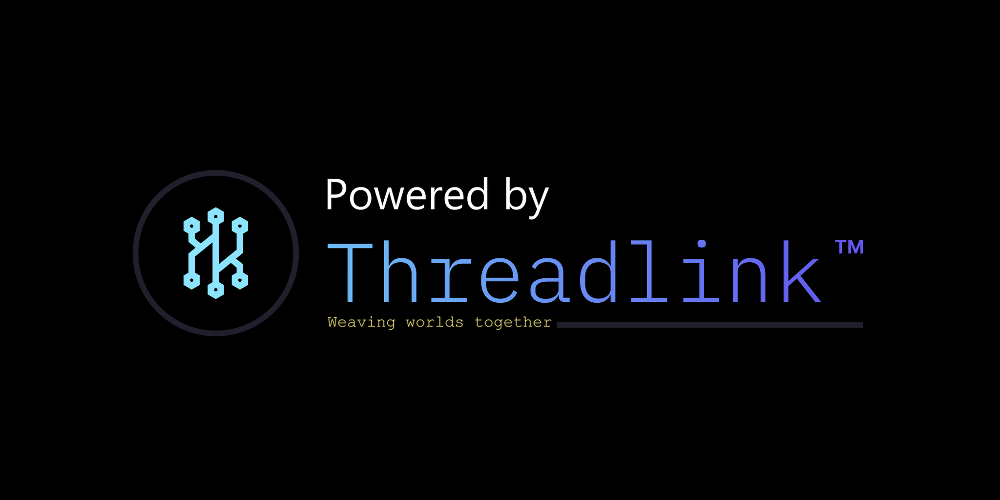

# Threadlink Framework

**Threadlink** is a Unity framework for the systems every game rebuilds: events, content loading, scene transitions, input and screens, audio, typed definitions, transactional saves, platform services, deterministic simulation and diagnostics. Each feature is a **subsystem** that Threadlink deploys before the first scene and reaches from anywhere: `Iris.Publish`, `Nexus.LoadAsync`, `Aura.Play`, `Dextra.Player`, `Sentinel.Saves`, `Vault.Get`, `Threadlink.LoadAsync`. Your own systems are subsystems too.

This is the reference for the Threadlink packages, their Editor tooling and their authoring workflows.

## Organisation

| Part | Audience | Contents |
|---|---|---|
| [Getting Started](getting-started/requirements.md) | All | Requirements, installation from OpenUPM, the Showcase and the starter project. |
| [Foundations](foundations/purpose.md) | All | Purpose, package families and dependency rules. |
| [Designer Reference](designer/README.md) | Content authors | Identifiers and tombstones, typed definitions, audio cues, input prompts and content registration. Requires no C#. |
| [Engineer Reference](engineer/README.md) | Programmers | Architecture and the API of every package, saving and platform providers, deterministic and memory tooling, diagnostics, Editor tooling and performance. |
| [Reference](reference/service-access.md) | All | Subsystem access, menus and asset-creation entries, terminology. |

> All API names, menu paths and asset-creation entries in this manual are drawn from package source. Capabilities that need hardware, accounts or SDKs that were not available for verification are identified as such.

## Where to start

- **New to Threadlink:** [Installation and Project Setup](getting-started/installation.md), then open the [Showcase](getting-started/showcase.md) from **Threadlink ▸ Workspace ▸ Hub**, then the [Starter Project](getting-started/starter.md).
- **Designers:** [Registering Content](designer/registering-content.md) and [Vault: Typed Definitions](designer/vault.md).
- **Engineers:** [Architecture](engineer/architecture.md), [Subsystem Access](reference/service-access.md) and [Iris](engineer/iris.md).

---

*Threadlink Framework — Reference Manual. Developed and maintained by Threadforge.*

*Lead Developer: George Rontoulis*
