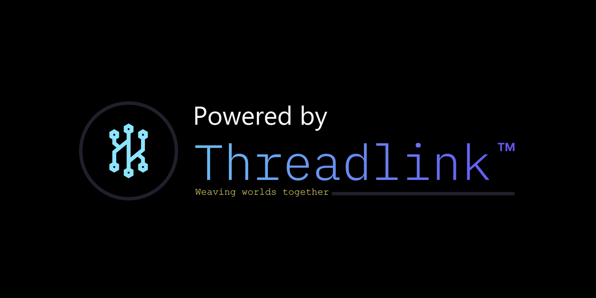

# Threadlink Framework

**Threadlink** is a modular runtime framework for Unity. It provides a core that deploys itself; subsystems for events, time, scenes, input and UI, audio and platform services; type-safe identifiers; a data container for designers; and deterministic maths for reproducible simulation.

This manual covers the runtime, the editor tools and the authoring workflow of **Threadlink 6.6**.

## Organisation

Threadlink separates authored data from code. The manual follows suit: a designer volume and an engineer volume, built on shared foundations.

| Part | Audience | Contents |
|---|---|---|
| [Getting Started](getting-started/requirements.md) | All | Requirements, installation and first-time project setup. |
| [Foundations](foundations/purpose.md) | All | Framework purpose, project layout, assembly topology, deployment overview. |
| [Designer Reference](designer/README.md) | Content authors | Identifiers, Vaults, spatial audio, input prompts, tuning and content registration. No C# needed. |
| [Engineer Reference](engineer/README.md) | Programmers | Architecture, deployment, subsystem APIs, the PlayerLoop, Sentinel, deterministic and memory tools, code generation, custom subsystems, editor tools and performance. |
| [Reference](reference/iris-events.md) | All | Native Iris events, service access, identifier domains, menus and asset-creation entries, terminology. |

Both volumes describe the same systems from opposite ends. Where the designer volume says *"declare the identifier in `Vault.Fields.User.txt`"*, the engineer volume explains the pipeline that generates `ThreadlinkIDs.Vault.Fields`, the manifest that keeps its values stable, and the API that reads it.

> API names, identifiers, menu paths, file paths and asset-creation entries are taken from the framework source. Systems that are stubbed or in development are marked as such.

## Where to start

- **New to Threadlink:** [Requirements](getting-started/requirements.md), then [Installation and Project Setup](getting-started/installation.md), then [Purpose](foundations/purpose.md).
- **Designers:** [The Identifier Workflow](designer/identifiers.md) and [The Vault](designer/vault.md).
- **Engineers:** [Architecture](engineer/architecture.md), [Deployment and Initialisation](engineer/deployment.md) and [Iris](engineer/iris.md).

---

*Threadlink Framework — Reference Manual. Developed and maintained by Threadforge.*

*Lead Developer: George Rontoulis*
