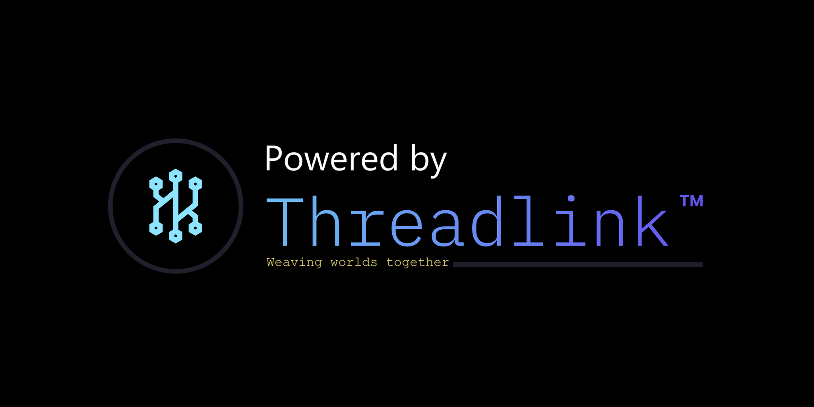

<p align="center">
  
</p>

# Threadlink Framework

**Threadlink** is a modular framework for Unity 6.6 that packages the systems every game rebuilds: session-wide subsystems, events, content loading, scene transitions, input and screens, audio, typed definitions, transactional saves and platform services. Scenes, prefabs and components stay ordinary Unity content; engineering settings live in Project Settings and designers edit data.

- **A self-deploying core.** Subsystems derive from `ThreadlinkSubsystem<T>`, register through a bundled source generator and deploy before the first scene. `Instance` and `TryGetSingleton` reach them from anywhere.
- **Codenamed features.** Iris (events), Nexus (scenes), Dextra (input, screens, interaction), Aura (audio), Sentinel (accounts, saves and platforms such as Steam) and Vault (typed definitions).
- **Generated, type-safe IDs.** Scenes, input actions, Addressables content, audio categories, platform data and your own ID domains are generated as typed IDs with stable values and tombstones, never strings.
- **Addressables as the source of truth.** The Content mapping ticks the entries game code loads by ID; prefabs load as GameObjects or their root components.
- **Zero-allocation async.** Asynchronous APIs return [UniTask](https://github.com/Cysharp/UniTask).
- **Deterministic and memory toolkits.** Fixed point, stateless random streams, native memory with stable hashing, and inline collections.

## Packages

| Package | Contents |
| --- | --- |
| `com.threadforge.threadlink` | The core: subsystems, Iris, content loading, Vault, generated IDs, engineering settings, memory toolkits and the Editor Workspace |
| `com.threadforge.threadlink.nexus` | Scene transitions for Build Profile and Addressables scenes |
| `com.threadforge.threadlink.aura` | Audio cues, categories, music and scene music |
| `com.threadforge.threadlink.dextra` | Per-player input and rebinding, screens and interaction |
| `com.threadforge.threadlink.sentinel` | Accounts, platform capabilities and transactional saves |
| `com.threadforge.threadlink.sentinel.steam` | Steam for Sentinel, through Unity's Steamworks package or Steamworks.NET |
| `com.threadforge.threadlink.deterministic` | Fixed point and StatelessRNG |
| `com.threadforge.threadlink.starter` | A small complete game built on Threadlink |
| `com.threadforge.threadlink.showcase` | A runnable demo of every feature |

Every first-party package shares one version: **1.0.0**. The packages live in [`Packages`](Packages).

## Requirements

Unity **6000.6** with Addressables, Input System and Collections; UniTask installs with the core. uGUI, Steamworks and Timeline are optional. See [Requirements](Gitbook/manual/getting-started/requirements.md).

## Installation

Threadlink installs from [OpenUPM](https://openupm.com). With the OpenUPM CLI:

```bash
openupm add com.threadforge.threadlink
```

Or add the OpenUPM registry to `Packages/manifest.json` with the scopes `com.threadforge` and `com.cysharp`, and install from **Window ▸ Package Manager ▸ My Registries**. Then open **Threadlink ▸ Workspace ▸ Hub** to install the other packages, the Starter and the Showcase. See [Installation and Project Setup](Gitbook/manual/getting-started/installation.md).

## Documentation

**Read it online: [threadforge.gitbook.io/threadlink-documentation](https://threadforge.gitbook.io/threadlink-documentation/)**

The reference manual is a GitBook space in [`Gitbook/manual`](Gitbook/manual/README.md), synced to that site and readable on GitHub:

| Start here | |
|---|---|
| [Introduction](Gitbook/manual/README.md) | What the manual covers and how it is organised. |
| [Designer Reference](Gitbook/manual/designer/README.md) | Content mapping, Vault, audio, input prompts and ID domains. No C#. |
| [Engineer Reference](Gitbook/manual/engineer/README.md) | Architecture, subsystems, the feature APIs, code generation and tooling. |
| [Reference](Gitbook/manual/reference/menus-and-assets.md) | Menus, asset creation, subsystem access and terminology. |

An offline, single-file edition ships as [`Threadforge/MarkdownDocumentation.md`](Threadforge/MarkdownDocumentation.md).

### Maintaining the documentation

- The pages in `Gitbook/manual` are the source of truth. Edit them in the repository, or in GitBook, whose Git Sync commits changes back.
- A new page must be listed in [`Gitbook/manual/SUMMARY.md`](Gitbook/manual/SUMMARY.md), which defines the navigation.
- After changing the manual, regenerate the single-file edition with `python Gitbook/tools/build_single_file.py`. `--check` reports whether it is out of date.
- **GitBook Git Sync** is connected to `main` at site level, with **Project directory** `Gitbook`. [`Gitbook/gitbook-docs.yaml`](Gitbook/gitbook-docs.yaml) maps the `threadlink-manual` space to `Gitbook/manual`; never change that key, or GitBook creates a new space. Every push to `main` updates the site. The root [`.gitbook.yaml`](.gitbook.yaml) serves space-level Git Sync, should the site ever be set up without a project directory.

## Development

The repository mirrors the framework's development project:

| Folder | Contents |
| --- | --- |
| [`Packages`](Packages) | The UPM packages, with their tests and samples |
| [`Threadforge/Development`](Threadforge/Development) | The validation runner (**Threadlink ▸ Validation ▸ Framework**), the code formatter and Showcase tooling |
| [`Threadforge/Threadlink User`](Threadforge/Threadlink%20User) | The development project's user folder: settings, examples and generated IDs |
| [`Tools`](Tools) | `release.py` (versions, checks, registry archives, OpenUPM metadata), `asmdef_guids.py` and the source generator |

- Change versions only with `python Tools/release.py apply <version>`, then `python Tools/release.py check`, which also verifies `.meta` files, changelogs and GUID references in assembly definitions.
- `python Tools/release.py pack <folder>` writes registry archives; `python Tools/release.py openupm <folder>` writes OpenUPM metadata. Each package is released on OpenUPM from its own Git tag, `<name>/<version>`, which `python Tools/release.py tags` lists.
- Assembly definitions reference other assemblies by GUID. After an automated edit, run `python Tools/asmdef_guids.py`.
- Rebuild the source generator with `python Tools/Generators/build.py --offline`; never edit its DLL by hand.

## License

[MIT](LICENSE). Developed and maintained by Threadforge. Lead Developer: George Rontoulis.
