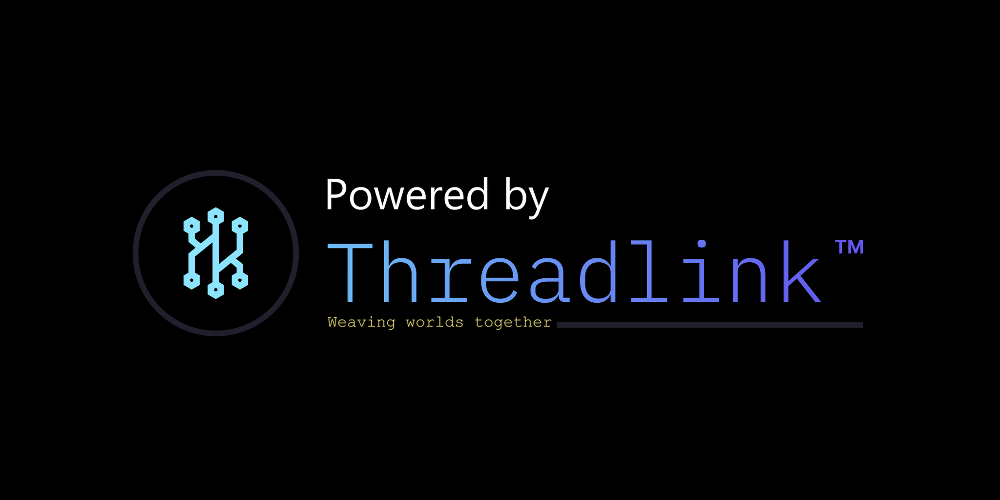

<!-- GENERATED FILE. Do not edit: the source is the GitBook manual in Gitbook/manual of the Threadlink repository. Regenerate with: python Gitbook/tools/build_single_file.py -->

# Threadlink Framework — Reference Manual

> This is the offline, single-file edition of the Threadlink reference manual, generated from the GitBook space in the repository's `Gitbook/manual` folder. The manual is online at [threadforge.gitbook.io/threadlink-documentation](https://threadforge.gitbook.io/threadlink-documentation/).




**Threadlink** is a Unity framework for the systems every game rebuilds: events, game time and pausing, content loading, scene transitions, input and screens, audio, typed definitions, transactional saves, platform services, deterministic simulation and diagnostics. Each feature is a **subsystem** that Threadlink deploys before the first scene and reaches from anywhere: `Iris.Publish`, `Chronos.Pause`, `Nexus.LoadAsync`, `Aura.Play`, `Dextra.Player`, `Sentinel.Saves`, `Vault.Get`, `Content.LoadAsync`. Your own systems are subsystems too.

This is the reference for the Threadlink packages, their Editor tooling and their authoring workflows.

## How this manual is organized

| Part | Audience | Contents |
|---|---|---|
| [Getting Started](#requirements) | All | Requirements, installation from OpenUPM, the Showcase and the starter project. |
| [Foundations](#purpose) | All | Purpose, package families and dependency rules. |
| [Designer Reference](#designer-reference) | Content authors | Identifiers and tombstones, typed definitions, audio cues, input prompts, localized text and content registration. Requires no C#. |
| [Engineer Reference](#engineer-reference) | Programmers | Architecture and the API of every package, saving and platform providers, deterministic and memory tooling, diagnostics, Editor tooling and performance. |
| [Reference](#subsystem-access) | All | Subsystem access, menus and asset-creation entries, terminology. |

> API names, menu paths and asset-creation entries in this manual come from the package source. Where a capability needs hardware, an account or an SDK to verify, the page says so.

## Where to start

- **New to Threadlink:** [Installation and Project Setup](#installation-and-project-setup), then open the [Showcase](#showcase) from **Threadlink ▸ Workspace ▸ Hub**, then the [Starter Project](#starter-project).
- **Designers:** [Registering Content](#registering-content) and [Vault: Typed Definitions](#vault-typed-definitions).
- **Engineers:** [Architecture](#architecture), [Subsystem Access](#subsystem-access) and [Iris](#iris-event-dispatch).

---

*Threadlink Framework — Reference Manual. Developed and maintained by Threadforge.*

*Lead Developer: George Rontoulis*

---

# Getting Started

## Requirements

### Unity

Threadlink packages declare Unity **6000.6**; the reference project and the starter's tested set use **6000.6.9f1**. Use the project's recorded Editor version for development and builds.

### Unity packages used by Threadlink packages

| Unity package | Version | Required by |
|---|---|---|
| Addressables (`com.unity.addressables`) | 2.11.2 | The core (content loading) |
| Collections (`com.unity.collections`) | 6.6.0 | The core (memory toolkits) |
| Input System (`com.unity.inputsystem`) | 1.20.1 | Dextra |
| Localization (`com.unity.localization`) | 1.5.14 | Dextra, Starter, Showcase (player-visible text) |
| Audio, Physics, Physics 2D and UI Elements modules | 1.0.0 | Aura, Dextra, the core's Editor workspace |
| uGUI (`com.unity.ugui`) | 2.6.0 | Optional: uGUI screens in Dextra |

### Optional packages

| Package | Effect |
|---|---|
| Universal or High Definition Render Pipeline (`com.unity.render-pipelines.universal`, `com.unity.render-pipelines.high-definition`), shipped with the Editor | Managed on **Threadlink ▸ Workspace ▸ Rendering**: install, create pipeline assets, choose the default and per-quality-level assets. Without one the project uses the Built-in Render Pipeline. |
| Steamworks API (`com.unity.steamworks-api`) | Enables the Unity backend of `sentinel.steam`. Import the SDK libraries through **Project Settings ▸ Steamworks**. |
| Steamworks.NET (`com.rlabrecque.steamworks.net`) 2024.8.0 or later | Enables the Steamworks.NET backend of `sentinel.steam`. Choose one Steam wrapper per project. |

Integrations compile only when the package they need is installed; no scripting define is needed.

### Bundled dependencies

| Package | Purpose |
|---|---|
| `com.threadforge.dependencies.messagepack` 3.1.12 | MessagePack runtime, annotations, source generator and analyzers, with System.Collections.Immutable and its string tools, for Sentinel saves. |

It keeps its upstream licenses and notices. Do not install duplicate copies of its DLLs under `Assets`.

### Scripting runtime

Threadlink targets .NET Standard 2.1 APIs, uses [UniTask](https://github.com/Cysharp/UniTask) 2.5.11 (`com.cysharp.unitask`, installed from OpenUPM with the core) for asynchronous work and does not depend on domain reload, `AppDomain`, `BinaryFormatter` or Mono-specific APIs, in preparation for Unity's CoreCLR runtime. Its validation runs Play mode with domain reload both enabled and disabled.

## Installation and Project Setup

Threadlink is a set of Unity packages published on [OpenUPM](https://openupm.com), a scoped registry that the Unity Package Manager installs from with dependencies resolved automatically. All Threadlink packages share one version; this manual describes **4.1.0**.

### Install with the OpenUPM command-line tool

With [openupm-cli](https://openupm.com/docs/getting-started-cli.html) installed, run from the project folder:

```bash
openupm add com.threadforge.threadlink
```

The command adds the OpenUPM registry with the `com.threadforge` and `com.cysharp` scopes and installs the core with its UniTask dependency. Add feature packages the same way, or install them all from the Hub (below). To install the whole framework in one command:

```bash
openupm add com.threadforge.threadlink com.threadforge.threadlink.nexus com.threadforge.threadlink.aura com.threadforge.threadlink.dextra com.threadforge.threadlink.sentinel com.threadforge.threadlink.deterministic
```

### Install through the Package Manager

1. Add the OpenUPM registry to `Packages/manifest.json`:

   ```json
   {
     "scopedRegistries": [
       {
         "name": "OpenUPM",
         "url": "https://package.openupm.com",
         "scopes": ["com.threadforge", "com.cysharp"]
       }
     ],
     "dependencies": {
     }
   }
   ```

2. Open **Window ▸ Package Manager**, select **My Registries**, and install **Threadlink**, then the features you want.
3. Alternatively, install by name with **+ ▸ Install package by name**, for example `com.threadforge.threadlink.aura`.

Unity 6 asks for confirmation the first time a project installs a package that a scoped registry serves without a Unity signature. Packages from OpenUPM are unsigned. Review the listed packages and accept; the Package Manager remembers the decision for the project.

### The Hub

The core includes **Threadlink ▸ Workspace ▸ Hub**: every package with its description and documentation, one-click install, update and removal, **Install Complete Framework**, sample import, and the [Showcase](#showcase). If the OpenUPM registry is missing, the Hub offers to add it.

### What installing does

Installed subsystems join the session automatically: they register at subsystem registration, deploy before the first scene's Awake and are usable from any script. Nothing is added to scenes. Packages with engineering settings work with defaults until you change them in **Project Settings ▸ Threadlink**. Optional integrations inside a package (Aura scene music with Nexus, screen sounds with Aura, uGUI screens) compile only when the package they need is installed.

Scripts in `Assembly-CSharp` see every Threadlink assembly. Assembly definitions reference the assemblies they use, for example `Threadforge.Threadlink` and `Threadforge.Threadlink.Aura`; add `Unity.ResourceManager` when using Addressables scene IDs.

### Set up the project

In the Hub, select **Set Up Project**. It creates the `Assets/Threadforge/Threadlink User` folders and two assembly definitions, each referencing every installed Threadlink runtime assembly:

| Assembly | Folder | Compiles |
| --- | --- | --- |
| `Threadlink.User.Generated` | `Engineering/Codebase/Generated` | The generated IDs (`GameScenes`, `GameInput`, `ContentAssets` and the rest), so any assembly can reference them |
| `Threadlink.User` | `Engineering/Codebase` | The project's code. It also references the generated IDs, UniTask, and the Addressables, Input System and Localization assemblies that are installed |

An assembly definition already in `Engineering/Codebase` keeps its name; Set Up adds the references it lacks. Run Set Up again after installing a package to add its assembly. The Hub's Project row and the **Project setup** validator show what is missing. Generating IDs also gives the generated folder its own assembly when no assembly definition compiles it.

### Offline installation

Every package is also available as a `.tgz` archive. In the Package Manager use **+ ▸ Install package from tarball** and install dependencies before the packages that need them, following each `package.json`. Archives of one release always share its version.

### Packages

| Package | Assembly | Contents |
| --- | --- | --- |
| `com.threadforge.threadlink` | `Threadforge.Threadlink` | The core: subsystems and the session, Iris events, content loading by typed ID (Addressables 2.11.2), Vault definitions, engineering settings, diagnostics, memory toolkits, and the Editor workspace with the Hub and Runtime monitor |
| `com.threadforge.threadlink.nexus` | `.Nexus` | Scene transitions for Build Profile and Addressables scenes |
| `com.threadforge.threadlink.aura` | `.Aura` | Audio cues, categories, music channel and scene music |
| `com.threadforge.threadlink.dextra` | `.Dextra` | Players and input (Input System 1.20.1), screens, interaction |
| `com.threadforge.threadlink.sentinel` | `.Sentinel` | Accounts, platform capabilities and saves |
| `com.threadforge.threadlink.sentinel.steam` | `.Sentinel.Steam` | Steam provider |
| `com.threadforge.threadlink.deterministic` | `.Deterministic` | Fixed point and StatelessRNG |
| `com.threadforge.threadlink.starter` | `.Starter` | A small complete game ([Starter Project](#starter-project)) |
| `com.threadforge.threadlink.showcase` | `.Showcase` | A runnable demo for every feature ([Showcase](#showcase)) |
| `com.threadforge.dependencies.messagepack` | — | MessagePack 3.1.12 runtime, annotations and source generator, used by Sentinel saves |

## Starter Project

`com.threadforge.threadlink.starter` is a small complete game on Threadlink: a main menu, a forest level with lanterns to collect, three save slots with recovery, settings with rebinding, music and screen sounds. Use it as a reference or as the starting point of a game.

### Install and play

1. Install `com.threadforge.threadlink.starter` (see [Installation](#installation-and-project-setup)), or select **Install** on its card in the Workspace Hub. Its dependencies install with it.
2. Import its **Starter** sample (Package Manager or Hub). The import sets up Unity Localization for the sample's English string table (see [Localizing Text](#localizing-text)).
3. Run **Threadlink ▸ Starter ▸ Add Starter Scenes To Build Profile**. It previews the list, puts `Starter Bootstrap`, `Starter Menu` and `Starter Forest` first and keeps your other scenes.
4. Open `Starter Bootstrap` (**Threadlink ▸ Starter ▸ Open Bootstrap Scene**) and enter Play mode.

Move with WASD or the left stick, interact with **E** or the south button, pause with **Escape** or Start.

### How it is built

The whole game flow is one subsystem, `StarterGame`. It uses Nexus, Aura, Dextra and Sentinel, which, like every subsystem, are running before the bootstrap scene starts. `StarterBootstrap` passes it the designer data and the menu appears at once; nothing waits for anything to become ready.

| Piece | Kind | Role |
| --- | --- | --- |
| `StarterGame` | Subsystem (code) | Menu, new game, continue, load, play, pause, save, autosave, settings, recovery |
| `StarterContent` | Designer data | Screens, sounds, first level, menu scene, slot count, autosave interval, input actions, panel and text |
| `LevelDefinition` | Designer data (Vault) | Localized level name, scene, music, spawn point, required lanterns |
| `StarterLevel`, `StarterPlayer`, `StarterCollectible`, `StarterExit` | Scene components | Restore and capture the level, move the player, lanterns and exit (both `Interactable`) |
| `StarterSave`, `StarterPreferences` | Save types | A slot's state; volumes and mute |

Screens are UI Toolkit documents opened with `Dextra.Screens.OpenAsync`; the game binds their controls through `ScreenHandle.Root` by element name. Levels and the menu name their scenes with `SceneReference` fields, which `Nexus.LoadAsync` loads; `StarterInput` holds the starter's input IDs (`StarterInput.Gameplay.Move`, `StarterInput.Maps.UI`), the same shape the generated `GameInput` has. When the project has no input actions in **Project Settings ▸ Threadlink ▸ Dextra**, the starter joins player 0 with its own actions.

### Saves, recovery and settings

- **New Game** uses the first empty slot; **Continue** loads the last played slot; **Load** lists every slot.
- Saving uses Sentinel's conflict detection: a slot changed elsewhere is reported, not overwritten.
- Autosave runs every `AutosaveSeconds` of play while no interaction, screen or transition is in progress.
- A damaged slot opens the recovery screen, which restores the previous version after validating it.
- Settings change volumes and mute immediately and save them when the screen closes; rebinding and **Reset** use Dextra, which saves bindings itself.

Saves are per local profile under `Application.persistentDataPath/Threadlink/Saves`. Open **Threadlink ▸ Runtime Monitor** in Play mode to watch the game subsystem, scenes, voices, screens and saves.

### Customizing

- Edit `Definitions/Forest` for the level, and `Configuration/StarterContent` for screens, sounds and tuning.
- Edit the UXML and USS under `UI`; keep the element names the game binds.
- Edit the text in the **Threadlink Starter** string table under `Localization`; screen labels bind to its entries, and `StarterContent` ▸ **Text** points at the entries the game fills in.
- Replace the placeholder tones in `Audio`.
- `StarterTint` colors the sample's primitives with the active render pipeline's default material. Replace it with authored materials in a real project.

## Showcase

The Showcase is a gallery with a runnable demo for every Threadlink feature. Each demo shows its controls, the packages it uses, an explanation of what it demonstrates and a live log.

### Open it

- From the Hub: **Threadlink ▸ Workspace ▸ Hub ▸ Install Showcase**, then **Open Showcase**. The Hub imports the sample and opens its scene.
- From the Package Manager: install `com.threadforge.threadlink.showcase`, import its **Showcase** sample and open `Scenes/Showcase.unity`.

Importing the sample sets up Unity Localization for its **Threadlink Showcase** string table (see [Localizing Text](#localizing-text)).

Enter Play mode and select a demo on the left.

### Demos

| Demo | Shows | Packages |
|---|---|---|
| Events | Synchronous events, worker posts, frame callbacks, owner-bound subscriptions | core |
| Awaited Events | Awaited events in order, requests with one responder | core |
| Subsystems | A project subsystem: registration, dependencies, `Instance` and `TryGetSingleton` | core |
| Content | Typed IDs, owner-bound requests, a custom content backend | core |
| Scenes | Transition steps; a failed transition keeps the current scene | `nexus` |
| Audio | Cues, category volume, fades, the music channel | `aura` |
| Input | Players, priority claims, action queries, prompts | `dextra` |
| Screens | UI Toolkit documents as screens on layers | `dextra` |
| Interaction | An `Interactable` found by an `InteractionSensor` | `dextra` |
| Vault | Designer assets prepared into immutable values with `Vault.Get` | core |
| Saving | Declared save types, slots, conflicts and restoring the previous version | `sentinel` |
| Platform | Local profiles, capability routing and explicit results | `sentinel` |
| Deterministic | Order-independent streams, fixed-point arithmetic | `deterministic` |
| Memory | Native blocks and cross-machine hashing | core |
| Operations | The session's operation log and subsystem reports | core |

The demos run without project setup in the live session: content uses a small generated-texture backend through `Content.UseBackend`, audio uses generated tones, and saves use slots 900 and above. Each demo's code is one file under `Runtime/Demos` in the Showcase package and uses only the public API. Open **Threadlink ▸ Runtime Monitor** while the gallery runs.

### Self-check

Every demo has a smoke check that exercises its features without input. The package's tests run all of them, and a player started with `-showcaseSmoke` runs them, writes `player-result.txt` next to the executable and quits.

---

# Foundations

## Purpose

Threadlink packages the systems most Unity games rebuild for every project: event dispatch, session-wide systems and their startup, content loading with clear ownership, scene transitions, input contexts and screen navigation, audio cues, typed definitions, transactional saves with recovery, platform services, deterministic numbers and randomness, and operation diagnostics.

Three rules shape every package:

- **The framework answers where things live.** Session-wide systems are subsystems owned by the Threadlink core: registered automatically, ready before the first Awake, shut down in reverse order, reached from anywhere. Game code never constructs a framework system or decides where to keep it.
- **Engineers own code, designers own data.** Composition is code; engineering settings live in Project Settings; designers edit cues, definitions, scene music, screens and tuning, which never select code. SDKs such as Steam stay off until an engineer enables them.
- **Unity stays authoritative.** Packages build on Unity's Input System, Addressables, AudioSource and AudioMixer, SceneManager, UI Toolkit and UGUI, and the profiler. Addressables keeps its own resource accounting; Threadlink adds request ownership and typed identities, not a second cache.

Operations that can fail report how they failed. Cancellation, partial failure, account changes and interrupted saves have defined outcomes, and [Diagnostics](#diagnostics) records them without changing behavior. Install only what you use: features are separate packages, and integrations between them compile only when both are installed.

## Package Layout

Threadlink is nine packages. Every package is named `com.threadforge.threadlink[.feature]`; every public type is in the `Threadforge.Threadlink` namespace, so one `using Threadforge.Threadlink;` reaches the whole framework. Packages follow the Unity package layout: `Runtime/`, optional `Editor/` and integration folders, `Tests/`, `Samples~/`, a changelog and third-party notices.

### Packages

| Package | Responsibilities |
|---|---|
| `com.threadforge.threadlink` | The core: subsystems and the session, Iris events, content loading, Vault definitions, engineering settings, diagnostics, memory toolkits, the source generator, and the Editor workspace with the Hub and Runtime monitor. |
| `.nexus` | Scene transitions. |
| `.aura` | Audio; scene music, with a Nexus integration. |
| `.dextra` | Players and input, screens, interaction; screen sounds (with Aura) and uGUI screens (with uGUI). |
| `.sentinel` | Accounts, platform capabilities, saves. |
| `.sentinel.steam` | Steam. |
| `.deterministic` | Fixed point and StatelessRNG. |
| `.starter`, `.showcase` | Samples: a small complete game and a gallery of demos. |

All Threadlink packages share one version. MessagePack comes as `com.threadforge.dependencies.messagepack`.

### Dependency rules

- Feature packages depend on the core; the core depends on no feature package.
- Integrations between features (Aura with Nexus, Dextra with Aura, Dextra with uGUI) are assemblies inside the package that compile only when the other package is installed.
- Runtime packages never reference project code. Generated project code (content IDs, subsystem registration) references packages, never the reverse.
- Diagnostics and the Workspace observe; removing them never changes behavior.

### Design and engineering in the project

| Folder | Contents |
| --- | --- |
| `Threadlink User/Engineering/Codebase` | Project subsystems and code |
| `Threadlink User/Engineering/Configs` | Engineering configuration: settings assets (edited in Project Settings ▸ Threadlink), Addressables, input, Localization settings and render pipelines |
| `Threadlink User/Design/Configs` | Designer configuration: locales and string tables |
| `Threadlink User/Design` | Designer data: cues, definitions (new ones from the Vault page go to `Design/Definitions`), documents, ID domains |

The configuration folders are defaults: choose others, per asset kind too, in **Threadlink ▸ Workspace ▸ Configuration** ([Configuration assets and folders](#configuration-assets-and-folders)).

The Hub's **Set Up Project** creates these folders and two assembly definitions: `Threadlink.User` for `Engineering/Codebase` and `Threadlink.User.Generated` for its `Generated` folder ([Set up the project](#set-up-the-project)).

Generated outputs, such as the content ID classes with their `.ids.json` ledgers, are written to `Threadlink User/Engineering/Codebase/Generated` ([Content mapping](#content-mapping)). Preserve `.meta` files and identity ledgers with the assets they describe.

---

# Designer Reference


This volume covers authoring in the Unity Editor without writing C#. Engineers decide which packages a project installs and which authoring types exist; designers create and tune the assets.

| Page | Covers |
|---|---|
| [Identifiers and Tombstones](#identifiers-and-tombstones) | How content and other identifiers stay stable through renames, moves and removals. |
| [Vault: Typed Definitions](#vault-typed-definitions) | The Vault page, field sets, and authoring definitions and variants with inherited overrides. |
| [Audio Cues](#audio-cues) | Creating cues, scene music, audio zones and screen sounds. |
| [Input Prompts and Rebinding](#input-prompts-and-rebinding) | Button glyphs, placing prompts, and how players rebind controls. |
| [Localizing Text](#localizing-text) | String tables for prompts, names and screen text; adding languages. |
| [Registering Content](#registering-content) | Mapping addressable assets, prefabs and scenes for loading by ID. |
| [Designer Procedures](#designer-procedures) | Step-by-step tasks. |

Designer data never selects code: engineering settings live in Project Settings and are not edited from the Inspector. Open **Threadlink ▸ Workspace** for one window with the project's content, definitions, input, localization, configuration and validation pages, and **Threadlink ▸ Runtime Monitor** in Play mode to see the running game.

## Identifiers and Tombstones

Saves, replays and generated code refer to content by identity, not by name or path. An identity is assigned once and never reused, so renaming or moving an asset never breaks existing data.

### Content identities

Every entry ticked in the [Content mapping](#registering-content) receives a value derived from its asset's GUID when it is first mapped.

- **Renaming, moving or regrouping** an asset keeps the value, so fields and saves that refer to it keep working; only the generated member's name and group follow the asset.
- **Unticking** an entry leaves its ID in the generated code as a **tombstone**, marked obsolete; code that still uses it produces a compiler warning, and loading it fails. The `.ids.json` ledger beside the generated class remembers it, and its value is never handed to other content.
- Never edit generated IDs, the ledger or the mapping in Project Settings by hand. Keep the ledger, the Content settings asset and `.meta` files under version control.

### Generated IDs

Scenes, input actions, audio categories and platform data (achievements, statistics, leaderboards, products) also have generated IDs. Scenes and input actions keep the identity Unity gives them (the scene asset's GUID, the action's ID), so renaming them keeps every reference working. Audio categories and platform data are identified by their names in Project Settings (platform data on each platform's page): renaming one removes the old ID. A removed ID stays in the generated code as an obsolete tombstone, recorded in the `.ids.json` ledger beside the class, until the code that uses it is updated. Fields that pick one of these, such as a level's scene or a cue's category, show a dropdown of what exists.

### Your own ID domains

When the game needs a fixed list of names, such as enemy kinds, spawn points or quest flags, ask for (or create) an **ID domain**: **Create ▸ Threadlink ▸ ID Domain**, or **Threadlink ▸ Workspace ▸ Code Generation ▸ New domain**. Add entries in the Inspector, with an optional description each. Engineers use the generated type in code, and fields of that type become dropdowns in the Inspector.

- An entry's value is fixed when you add it; renaming it keeps the value, so anything that already uses it keeps working.
- Removing an entry keeps it as an obsolete tombstone in the code until engineers update the code that uses it. Its value is never reused.
- Set **Owner** to **Design** for lists designers maintain; the asset then lives in `Design/Identifiers`.

### Deterministic domains

A StatelessRNG domain separates the random numbers of one system from another. Engineers declare domains in code as `StatelessRNG.Domain` values, either with an explicit number or from a name. A domain's value is part of the save and replay format: changing it changes every number drawn under it. Rename a domain's code accessor freely, but keep its value.

## Vault: Typed Definitions

**Vault** holds the game's typed definitions. A Vault asset is an authored definition (an enemy's stats, an item, a level's rules) that the game prepares into an immutable runtime value. Engineers create definition types; designers create and tune the assets, and can build **field sets** with no code at all. Definitions are part of the Threadlink core; code reads them with `Vault.Get`.

### The Vault page

**Threadlink ▸ Workspace ▸ Vault** lists every definition in the project, grouped by type. Type in the filter to narrow it by name, type or folder, and select a definition to edit it beside the list. ⚠ marks a definition that needs an authoring migration.

- **New** creates a definition of any type that has a creation menu entry, beside the selected one (or in `Threadlink User/Design/Definitions`).
- Right-click a definition to ping, duplicate or delete it. A duplicate gets its own identity.
- To open a definition on the page, right-click it in the Project window and choose **Threadlink ▸ Open in Vault Page**, or use **Open in Vault Page** in its Inspector's context menu.

Edits made in Play mode change the asset and are kept after Play mode ends; the running game keeps the value it already prepared.

### Field sets

A **field set** is a definition made of named values, for data that does not need its own type: an enemy's damage and portrait, a weapon's range, a level's par time.

1. Create one with **Create ▸ Threadlink ▸ Vault ▸ Field Set**, or **New ▸ Threadlink ▸ Vault ▸ Field Set** on the Vault page.
2. Add a field, pick its ID from the dropdown and choose its kind: a number, text, true/false, a vector, color or rotation, or a reference to an asset such as a sprite or prefab.
3. Enter the value.

The field IDs come from an [ID domain](#your-own-id-domains) that extends **Vault fields**: add an entry there to make a new field available. Each field may appear once in a set. To make a family of similar sets, set a **Parent**: the set inherits every field of its parent, and fields you add replace the inherited ones of the same ID. **Create Typed Variant** in the Inspector makes such a child.

### Creating typed definitions

Use the asset creation menu entry the engineering team added for the type (for example **Create ▸ Game ▸ Enemy Definition**), or **New** on the Vault page. A new asset receives a permanent identity and the type's current schema version. Moving or renaming the asset keeps its identity.

The Inspector shows the identity, schema and authored version. **Validate Vault Asset** checks the asset; a definition that fails validation also fails explicitly when the game prepares it, never silently.

### Variants and overrides

**Create Typed Variant** in the Inspector makes a child asset of the same type. A variant inherits every value from its parent and changes only the fields whose override is enabled:

- Enable an override to replace the inherited value.
- **Inherit** (shown per field) disables that override again; the parent's value applies.
- The Inspector shows where each value comes from along the parent chain.

Variants can have variants. A variant whose parent changes schema becomes invalid until it is migrated with the parent.

### Authoring migrations

When engineers change a definition type, they raise its schema version and write a conversion. Older assets then show a version mismatch. Select them and use **Apply Explicit Authoring Migration** in Edit mode; the Inspector records Undo and restores the asset if conversion fails. Builds never upgrade definitions silently, so migrate every listed asset before building.

Definition versions are separate from save-file migrations: changing a definition does not change saved games.

## Audio Cues

An **audio cue** describes one sound the game can play: which clips, how loud, how varied, where in space and how important. Create one with **Create ▸ Threadlink ▸ Aura ▸ Audio Cue**.

| Setting | Effect |
|---|---|
| Variations | Clips with weights. A weighted random variation plays each time; Avoid Immediate Repeat (on by default) skips the clip that just played. |
| Volume and pitch | Ranges sampled per playback. |
| Loop | Plays until stopped. |
| Spatial Blend, Minimum and Maximum Distance | From 2D (0) to fully 3D (1), with the distance range for 3D rolloff. |
| Category | Groups cues for shared volume, muting, fades and voice limits; choose one of the project's categories from the dropdown (the default is `Effects`). |
| Mixer Group | The Audio Mixer group the sound plays through. |
| Priority | Decides which voices survive when a limit is reached (128 by default). |
| Voice Limit and Overflow | How many instances may play at once (16 by default), and whether a new playback is rejected (the default) or steals a lower-priority voice. |
| Loading Policy | Selected Variation prepares only the clip about to play; Preload Variations prepares every variation ahead of playback. |

Players' volume settings adjust category volumes. Mixer snapshots (for example a muffled pause-menu mix) are authored in the Audio Mixer as usual.

### Scene music

Add **Add Component ▸ Threadlink ▸ Aura ▸ Scene Music** to any object in a scene and assign a looping cue. When the scene starts, the music crossfades to it (leave the cue empty to fade the music out). Set a crossfade on the component, or leave it negative to use the project default. When scenes change through Nexus, the music is prepared while the next scene loads and starts as it appears, so a failed transition never interrupts the current track. A music cue that cannot start (for example because its category is full) never affects the scene; use a stealing overflow policy for music.

### Audio zones

An **Audio Zone** turns some sounds down near a place, such as the music under a waterfall, and can play a sound there.

1. Add **Add Component ▸ Threadlink ▸ Aura ▸ Audio Zone** to an object at the place.
2. Set the **Radius**: beyond it the zone does nothing. The Scene view shows it as a sphere when the object is selected.
3. Under **Lowers**, choose each category to turn down and how much (1 silences it at the zone's center). The effect grows from nothing at the radius to the full amount at the center.
4. Optionally assign a looping **Cue** that plays at the zone while it is enabled.

### Screen sounds

Add **Add Component ▸ Threadlink ▸ Dextra ▸ Screen Sounds** to a screen prefab and assign open, close and focus cues, and, for UI Toolkit screens, navigate and submit cues played as the player moves between and presses controls. A screen that fails to open makes no sound, and a sound that cannot play never blocks a screen.

## Input Prompts and Rebinding

Input uses Unity Input System action assets. Each player gets their own copy of the actions, paired with that player's devices, so prompts and rebinds for one player never affect another.

### Prompts

A prompt names the control for an action on the device the player used last. If the team supplies glyphs (button icons), prompts show the glyph; otherwise they show the control's readable name, such as `Space` or `Button South`. Prompts switch automatically when the player changes device.

### Glyphs

To show button images instead of names, create **Create ▸ Threadlink ▸ Dextra ▸ Input Glyphs** and add an entry per control:

| Setting | Meaning |
| --- | --- |
| Device | Keyboard & mouse, Xbox, PlayStation, Switch, any gamepad, or any device. The device's own family wins, then "any gamepad", then "any device". |
| Control | An Input System control path, such as `<Gamepad>/buttonSouth` or `<Keyboard>/space`. |
| Sprite | The image. |

Engineering assigns the asset to **Glyphs** in **Project Settings ▸ Threadlink ▸ Dextra**. Prompts then show the glyph of the device the player used last, and the control's name where no glyph matches.

To place a prompt:

- In a UI Toolkit document, add the **Input Prompt** element (`Threadforge.Threadlink.InputPrompt`) and set its **Action** to the action's "Map/Action" path.
- On a uGUI canvas, add **Add Component ▸ Threadlink ▸ Dextra ▸ Input Prompt**, assign the action, an Image for the glyph and, optionally, a Text for the name.

Both follow device changes and rebinds by themselves.

### Rebinding

Rebinding listens for the next control on the player's own devices. Composite bindings such as WASD are rebound one part at a time. Cancelling restores the previous bindings. When a new binding conflicts with another action, the game decides whether to accept it and clear the other binding. Rebinds are saved for each player automatically and restored the next time the game starts; resetting restores the action asset's defaults.

### Contexts

Gameplay, menus and cutscenes enable different action maps through claims with priorities. A blocking claim (for example an open menu) suspends lower-priority input until it is released, then the earlier input returns unchanged.

## Localizing Text

Threadlink shows player-visible text through Unity Localization (`com.unity.localization`). Text fields are `LocalizedString` references: a string table and an entry in it. Each field follows the selected language, and the Inspector edits it with Localization's table and entry picker.

### What is localized

| Text | Where it is authored |
|---|---|
| Interaction prompts | The **Prompt** field of every `Interactable` (Dextra) |
| Starter level names | `LevelDefinition` ▸ **Display Name** |
| Starter collectible names | `StarterCollectible` ▸ **Display Name**, inserted into its prompt as `{item}` |
| Starter messages, slot labels, settings and control names | `StarterContent` ▸ **Text**, and its string table |
| Starter screen labels and buttons | Bindings in the screens' UXML documents |
| Showcase demo text | The **Threadlink Showcase** string table |

Input prompts name controls and devices from the Input System (`Space`, `Button South`), or show the team's glyphs; they are not table entries. See [Input Prompts and Rebinding](#input-prompts-and-rebinding).

### Setup

Open **Threadlink ▸ Workspace ▸ Localization** and select **Set up**. It creates what is missing and is safe to run again:

- Localization settings in the engineering configs folder and the English (`en`) locale in the design configs folder (see [Configuration assets and folders](#configuration-assets-and-folders)).
- Registration of every string table collection for loading. Localization loads tables through Addressables.

Importing the Starter or Showcase sample runs it automatically, because each sample brings an English string table collection: **Threadlink Starter** and **Threadlink Showcase**, under the sample's `Localization` folder. The Starter's validator reports a project that is not set up.

### Adding a language

1. On the Workspace's **Localization** page, pick the language in **Add locale** and select **Add**. The locale is created in the Locales folder, and every string table collection gets a table for it.
2. Translate the entries: **Open** a string table, or use **Tables window**.
3. Choose how the game selects the language in **Project Settings ▸ Localization** (locale selectors).

**New string table** creates a collection with a table for every locale in the String Tables folder. **Folder…** on the Locales and String Tables rows chooses where new ones go.

Entries are matched by key, so translations never change the assets that reference them.

### Writing entries

- Give each piece of text its own entry. Do not build sentences from fragments; word order differs between languages.
- Entries with `{0}`, `{1}` take values from the game, such as a slot number. Keep the placeholders in every translation.
- Smart entries take named values. The Starter's `take-item` entry is `Take {item}`, where `{item}` is the collectible's own localized name.
- A prompt with no table or entry shows nothing. The Starter's validator reports unassigned **Text** entries and level names.

## Registering Content

Content the game loads at runtime is managed by **Addressables**: its Groups window decides which assets are addressable, their addresses, labels, groups and how they are built and delivered. Threadlink does not duplicate any of that. The **Content mapping** only decides which addressable entries game code loads by ID.

### Map an entry

1. Make the asset addressable in **Window ▸ Asset Management ▸ Addressables ▸ Groups** (or tick **Addressable** in its Inspector).
2. Open **Threadlink ▸ Content Mapping** (the Workspace's **Content** page). Every editable Addressables group is listed with its entries.
3. Tick the entry, then **Apply**. **All** and **None** tick every shown entry of a group; the filter narrows the list by name.
4. Tell engineering the ID: a prefab `Slime` in the group `Characters` becomes `ContentPrefabs.Characters.Slime`.

Threadlink sorts each entry by how it loads:

| Kind | Entries | Generated class |
|---|---|---|
| Asset | Sprites, clips, cues, materials, any other asset | `ContentAssets` |
| Prefab | Prefabs | `ContentPrefabs` |
| Scene | Scenes | `ContentScenes` |

You can also select assets in the Project window and choose **Assets ▸ Threadlink ▸ Map for Loading by ID**. Fields that refer to content, such as a level's music, show a dropdown of the mapped entries.

The mapping itself is in **Project Settings ▸ Threadlink ▸ Content**: three read-only dictionaries of IDs and Addressables references, written when you apply.

### Labels

Addressables labels need no mapping: each label generates `ContentLabels.Name`, which loads every asset with that label in one request.

Removing or renaming content follows the rules in [Identifiers and Tombstones](#identifiers-and-tombstones).

## Designer Procedures

### Making an asset loadable

1. Make the asset addressable in the Addressables Groups window.
2. Open **Threadlink ▸ Content Mapping**, tick the entry and press **Apply**.
3. Tell engineering the ID, such as `ContentAssets.Characters.HeroPortrait`.

### Retiring content

1. Untick the entry in the Content mapping and press **Apply**. The ID becomes a tombstone, and code still using it produces a warning.
2. Remove the asset from Addressables only after engineering has updated the code.

### Adding tunable values without code

1. Add the value's ID to an ID domain that extends **Vault fields** (for example `Damage`).
2. Create a field set (**Create ▸ Threadlink ▸ Vault ▸ Field Set**), add the field, choose its kind and enter the value.
3. Tell engineering the field set and the ID, such as `VaultFields.Damage`.

### Tuning a definition

1. Select the definition asset or the variant you want to change, in the Project window or on the Workspace's **Vault** page.
2. In a variant, enable the override for each value you change; leave the others inherited.
3. Select **Validate Vault Asset** in the Inspector to check it.

### Adding a sound

1. Create an audio cue with **Create ▸ Threadlink ▸ Aura ▸ Audio Cue**.
2. Add clip variations, set the category and mixer group, and choose a voice limit and overflow policy.
3. Assign it where a component expects a cue: **Scene Music** for a scene's music, **Screen Sounds** for a screen, or a game component.

### Checking the project

Open **Threadlink ▸ Workspace** and select **Validation**. Errors identify assets the game would reject at runtime; warnings identify likely problems.

### Operating principles

- Identities are permanent: rename freely, but never reuse an identity for something else.
- Keep `.meta` files and identity ledgers with their assets.
- A failed validation is information, not an obstacle to hide: fix the asset rather than the check.

---

# Engineer Reference


This volume documents every package's API and the contracts behind it.

| Page | Covers |
|---|---|
| [Architecture](#architecture) | The core, subsystems, the session, design and engineering, asynchronous work and failure reporting. |
| [Lifetimes](#lifetimes) | Subscriptions and content bound to the game object that needs them. |
| [Iris](#iris-event-dispatch) | Synchronous and awaited events, requests, frame callbacks and externally driven frames. |
| [Framework Events](#framework-events) | What the framework announces on Iris, and when to subscribe. |
| [Chronos](#chronos-time) | Pause claims, the time scale and playtime. |
| [Nexus](#nexus-scene-management) | Scene transitions, holds and transition steps. |
| [Dextra](#dextra-input-screens-and-interaction) | Players and input, rebinding, prompts and glyphs, screens and Back, interaction. |
| [Aura](#aura-audio) | Audio cues, voices, categories, fades, music, scene music and audio zones. |
| [Sentinel](#sentinel-platform-services) | Accounts, capabilities, providers, saving, cloud sync and invitations. |
| [Vault Runtime API](#vault-runtime-api) | Typed definitions, generated mapping, variants, field sets and preparation. |
| [Serialization](#serialization) | Snapshot envelopes, the MessagePack codec and versions. |
| [Resource Loading](#resource-loading) | Typed content requests, the Content mapping, labels and finding assets by type. |
| [Deterministic Toolkit](#deterministic-toolkit) | Fixed point and StatelessRNG. |
| [Memory](#memory) | Native allocation, hashing and inline collections. |
| [Diagnostics](#diagnostics) | Subsystem reports and the operation log. |
| [Editor Tooling](#editor-tooling) | The Workspace, project setup, the Scenes toolbar, the Runtime monitor, generated IDs, engineering settings, inspector helpers, validators and development tools. |
| [Performance](#performance) | Measured costs and allocation guidance. |
| [Engineering Procedures](#engineering-procedures) | Common tasks step by step. |

## Architecture

Threadlink owns the parts of a game that live for the whole session. Each part is a **subsystem**; the **core** creates, orders, links and shuts them down. Game code never decides where a framework object lives or when it starts.

### The session

| Moment | What happens |
| --- | --- |
| `RuntimeInitializeLoadType.SubsystemRegistration` | Every subsystem class registers itself. Generated code does this; nothing scans assemblies. |
| `RuntimeInitializeLoadType.BeforeSceneLoad` | The core deploys in two phases. Iris boots and initializes first. Then every other subsystem **boots**, then every one **initializes**. `ThreadlinkReady` is announced on Iris. |
| First scene's `Awake` and `Start` | Every subsystem is ready. Nothing waits. |
| Leaving Play mode, code reload, player quit | `SessionEnding` is announced, the session's `Threadlink.Lifetime` token is cancelled, every subsystem **deinitializes** in reverse initialization order, then every one **shuts down** in reverse boot order. |

Startup is synchronous. Work that is genuinely asynchronous, such as reading a save, loading a scene or calling a platform service, is an ordinary `UniTask` call the game makes when it needs it, never a precondition for `Start`.

#### Two phases instead of a dependency order

Boot and initialization split what a subsystem does to itself from what it does with others, so no subsystem declares what it depends on and the order between them never matters.

| Phase | Hook | Does | May use |
| --- | --- | --- | --- |
| Boot | `OnSubsystemBoot()` | Sets up the subsystem's own state, creates its objects, subscribes to Iris events. | Only itself and Iris. Using any other subsystem throws, with the fix in the message. |
| Initialize | `OnSubsystemInit()` | Connects to other subsystems, registers with them, announces readiness on Iris. | Every subsystem, in any order: all have booted. |
| Deinitialize | `OnSubsystemDeinit()` | Disconnects from other subsystems. | Every subsystem: none has shut down yet. |
| Shut down | `OnSubsystemShutdown()` | Releases the subsystem's own state. | Itself and Iris. |

Some state only exists once a subsystem has initialized: Steam signed in, or a platform's account selected. You can't read it reliably from your own `OnSubsystemInit`, because the other subsystem may initialize after yours. Instead, that subsystem announces the change on Iris, and you react to the event:

- **Subscribe in `OnSubsystemBoot`.** Every subsystem boots before any initializes, so all subscriptions exist before the first announcement.
- **Publish from `OnSubsystemInit` or later.** Subsystems boot in no set order, so an event published during boot can reach a subsystem that has not subscribed yet.

An event reaches only the subscribers listening when it is published; Iris never replays one. See [Framework Events](#framework-events).

Keep both phases to the work that has to happen before the first scene: wiring, subscriptions, starting an SDK that must start early. Loading, waiting and reading files belong to the asynchronous APIs, after startup.

### Subsystems

Derive from `ThreadlinkSubsystem<T>`. The bundled source generator registers every concrete subsystem in assemblies that reference Threadlink; mark a class `[ManualRegistration]` to keep it out of the session (tests and tools add such subsystems explicitly).

```csharp
using Threadforge.Threadlink;

public sealed class Wallet : ThreadlinkSubsystem<Wallet>
{
    private SubscriptionToken account;

    public int Coins { get; private set; }

    // Its own state, and its subscriptions: the account is announced while Sentinel and the platforms initialize.
    protected override void OnSubsystemBoot() => account = Iris.Subscribe<AccountChanged>(changed => Coins = 0);

    protected override void OnSubsystemShutdown() => account.Dispose();

    public static void Add(int amount)
    {
        Instance.Coins += amount;
        Iris.Publish(new CoinsChanged(Instance.Coins));
    }

    public override void Report(MonitorReport report) => report.Summary(Coins + " coins");
}
```

| Member | Meaning |
| --- | --- |
| `OnSubsystemBoot()` | Startup phase one: set up the subsystem itself and subscribe to Iris. Throwing fails only this subsystem. |
| `OnSubsystemInit()` | Startup phase two: connect to other subsystems through their `Instance`. Throwing fails this subsystem; a subsystem whose initialization uses a failed one fails with the chain in its error. |
| `OnSubsystemDeinit()` | Shutdown phase one, in reverse initialization order: disconnect from other subsystems. |
| `OnSubsystemShutdown()` | Shutdown phase two, in reverse boot order: release the subsystem's own state. |
| `Instance` | The subsystem in the current session. Throws `SubsystemUnavailableException` with the reason when it is not part of the session or failed, and `InvalidOperationException` when used from another subsystem's boot. |
| `TryGetSingleton(out T)` | Whether the subsystem is part of the current session and available. It never starts one. |
| `State`, `Error` | `Registered`, `Booting`, `Booted`, `Initializing`, `Ready`, `Failed` or `ShutDown`, and why it failed. |
| `Dependencies` | The subsystems this one used while it initialized, shown in the Runtime monitor's graph. |
| `Lifetime` | Cancelled when the session ends. |
| `Report(MonitorReport)` | What the Runtime monitor shows. |

Framework subsystems follow the same pattern and expose their API as static methods on the class: `Iris.Publish`, `Chronos.Pause`, `Nexus.LoadAsync`, `Aura.Play`, `Dextra.Player`, `Sentinel.Saves.SaveAsync`, `Vault.Get`. Content loading lives on the core: `Content.LoadAsync`.

### The core

| API | Meaning |
| --- | --- |
| `Threadlink.TryGetSingleton(out Threadlink)` | Whether a core is deployed and linked. |
| `Threadlink.IsDeployed`, `Threadlink.Instance` | Deployment state and the current core. |
| `Threadlink.Lifetime` | Cancelled when the session ends. |
| `core.Subsystems` | Every subsystem in initialization order, then any that failed. |
| `Threadlink.Operations`, `Threadlink.BeginOperation` | The session's operation log. See [Diagnostics](#diagnostics). |
| `Threadlink.DeployIsolated()` | A separate core for tests and tools; it becomes current until disposed and starts empty. `core.Add<T>()` boots and initializes a subsystem; one that another uses joins on first use. |

### Design and engineering

| Kind | Lives in | Edited by |
| --- | --- | --- |
| Composition and behavior | Code: subsystems, components, save types | Engineers |
| Engineering settings | `ThreadlinkSettings<T>` assets in `Engineering/Configs` or the folder chosen on the Workspace's Configuration page, edited only in **Project Settings ▸ Threadlink**, read-only in the Inspector, preloaded in players | Engineers |
| Designer data | Assets and scene components: `AudioCue`, `SceneMusic`, `VaultAsset`, screen documents, tuning values | Designers |

Designer data holds values only: it never selects types, services or wiring.

### Asynchronous work

Every asynchronous API returns [UniTask](https://github.com/Cysharp/UniTask) (`UniTask` or `UniTask<T>`, namespace `Cysharp.Threading.Tasks`), which the core installs as a dependency. UniTask pools its async machinery, so steady-state asynchronous work does not allocate, and an `async UniTask` method that completes synchronously allocates nothing in release builds. Write your own listeners, steps and interactions as `async UniTask` methods and use UniTask's own helpers: `UniTask.CompletedTask`, `UniTask.FromResult`, `UniTask.WhenAll`, `UniTask.NextFrame`, `UniTask.WaitForSeconds`.

- Await a UniTask once. To await one result in several places, call `.Preserve()` first.
- Start work you do not await with `.Forget()`, so a failure is reported immediately; a discarded faulted UniTask is reported later as an unobserved exception.
- The Editor compiles scripts in Debug mode, where every `async` method allocates its state machine once per call. Measure allocations in a player build or with the Editor's code optimization set to Release.

### Outcomes

Operations report how they failed. Content requests, transitions, saves and platform calls return or throw explicit states (cancelled, failed, conflict, corrupt data, unsupported, unavailable) and never succeed silently.

## Lifetimes

The Threadlink core owns every subsystem for the session (see [Architecture](#architecture)). Inside game objects, bind what you subscribe to or load to the object that needs it: the subscription or the content is released when that object is destroyed, so a destroyed component never receives events or keeps content loaded.

```csharp
public sealed class CoinLabel : MonoBehaviour
{
    [SerializeField] private Text label;
    [SerializeField] private Image image;

    private async void Start()
    {
        Iris.Subscribe<CoinsChanged>(this, change => label.text = change.Total.ToString());
        var icon = await Content.LoadAsync<Sprite>(ContentAssets.Interface.Coin, this);
        image.sprite = icon.Asset;
    }
}
```

| API | Released when the owner is destroyed |
| --- | --- |
| `Iris.Subscribe<T>(owner, callback)`, `Iris.SubscribeAsync<T>(owner, listener)`, `Iris.Respond(owner, responder)` | The subscription or responder. |
| `Iris.OnUpdate(owner, …)`, `OnFixedUpdate`, `OnLateUpdate` | The frame callback. |
| `Content.LoadAsync(id, owner)`, `LoadAllAsync(label, owner)` | The loaded content. |
| `Content.InstantiateAsync(id, owner)` | The instance and the content it came from. |

Without an owner, the call returns what you release yourself: dispose the `SubscriptionToken`, the responder or the `ResourceRequest`, usually with `using` or in `OnDestroy`.

## Iris: Event Dispatch

Iris is the session's event system, in the core package (`com.threadforge.threadlink`). Use it from the main thread; workers queue events with `TryPost`.

Iris boots and initializes before every other subsystem, and it is the one subsystem others may use while they boot. Subscribe in `OnSubsystemBoot` and you hear everything other subsystems announce while they initialize, whatever their order. The framework announces its own state changes on Iris: see [Framework Events](#framework-events).

### Synchronous events

```csharp
public readonly struct CoinsChanged
{
    public readonly int Total;
    public CoinsChanged(int total) => Total = total;
}

public sealed class CoinLabel : MonoBehaviour
{
    private void Start() => Iris.Subscribe<CoinsChanged>(this, change => text.text = change.Total.ToString());
}

Iris.Publish(new CoinsChanged(12));
```

| API | Behavior |
| --- | --- |
| `Iris.Subscribe<T>(callback)` | Returns a `SubscriptionToken`; dispose it to stop delivery. Copies and repeated disposal never remove another listener. |
| `Iris.Subscribe<T>(owner, callback)` | Ends when the `MonoBehaviour` owner is destroyed. |
| `Iris.Publish<T>(value)` | Delivers now, in subscription order. A listener that throws is logged and the others still run. |
| `Iris.TryPublish<T>(value)` | As `Publish` when Iris is available; returns false otherwise, such as in a test session without Iris. Framework events use it. |
| `Iris.TryPost<T>(value)` | From any thread: queues the event for the next Update. Returns false when the bounded queue is full or Iris is not linked. |
| `Iris.ListenerCount<T>()` | Current synchronous listeners. |

Additions during a publication take effect for the next publication; removals take effect immediately. Warm synchronous delivery allocates nothing.

### Frame callbacks

`Iris.OnUpdate(owner, deltaTime => …)`, `OnFixedUpdate` and `OnLateUpdate` run after the corresponding MonoBehaviour phase and end with their owner. Iris also publishes `UpdateFrame`, `FixedFrame` and `LateFrame` (each with `DeltaTime`) for `Iris.Subscribe`. Iris inserts its markers into the PlayerLoop while it is linked and removes only its own markers at shutdown; a test session inside Play mode reuses the running session's markers.

#### Driving frames from another simulation

When another framework owns the simulation, such as a deterministic or networked one, it decides when frames happen. `Iris.DriveFramesExternally()` removes Iris's markers until the returned object is disposed; meanwhile the simulation publishes each frame with `Iris.RunUpdate(deltaTime)`, `RunFixedUpdate` and `RunLateUpdate`. Frame callbacks, frame events and posted events work the same either way. `Iris.FramesAreExternal` tells which mode is active, and calling `RunUpdate` while Iris publishes frames itself throws.

```csharp
private IDisposable frames;

protected override void OnSubsystemInit() => frames = Iris.DriveFramesExternally();
protected override void OnSubsystemDeinit() => frames.Dispose();

private void OnSimulationTicked(float step) => Iris.RunFixedUpdate(step);
```

### Awaited events and requests

```csharp
Iris.SubscribeAsync<LevelCompleted>(this, async (done, token) => await fader.FadeOutAsync(token));
Iris.SubscribeAsync<LevelCompleted>(this, async (done, token) => await SaveAsync(token));
await Iris.PublishAsync(new LevelCompleted(3));     // each listener in order, each awaited

Iris.Respond<NextLevel, int>(this, (request, token) => UniTask.FromResult(request.After + 1));
int next = await Iris.RequestAsync<NextLevel, int>(new NextLevel(3));
```

| API | Behavior |
| --- | --- |
| `PublishAsync` | Awaits listeners one after another in subscription order. Cancellation is checked before each listener and passed to every listener. A failure stops the sequence and propagates. |
| `PublishConcurrentAsync` | Starts every listener and awaits all; one failure is rethrown, several are aggregated. |
| `Respond` / `RequestAsync` | Exactly one responder per request and response type. A request without a responder throws `NoResponderException`. |

Listeners return `UniTask`. Publication adds no allocation: warmed sequential and concurrent publications reuse their buffers, and listeners written as `async UniTask` use UniTask's pooled machinery.

## Framework Events

The framework announces its state changes on [Iris](#iris-event-dispatch), so game code reacts to them instead of polling or depending on startup order. Every event is a `readonly struct`, delivered synchronously with `Iris.TryPublish`: a listener that throws is logged and the others still run.

### Listening

An event reaches the subscribers that are listening when it is announced; Iris never replays one. Subscribe before the events you need are announced: a subsystem subscribes while it boots. Iris boots before every other subsystem, and every subsystem boots before any initializes, so a boot-time subscriber hears everything announced during initialization and afterwards, whatever the order between subsystems:

```csharp
public sealed class OnlineBadge : ThreadlinkSubsystem<OnlineBadge>
{
    private SubscriptionToken ready;

    protected override void OnSubsystemBoot() =>
        ready = Iris.Subscribe<PlatformReady>(platform => Debug.Log(platform.Provider + " is ready"));

    protected override void OnSubsystemShutdown() => ready.Dispose();
}
```

A component subscribes with an owner, so the subscription ends when it is destroyed; it hears what is announced while it exists:

```csharp
private void Start() => Iris.Subscribe<DeviceLost>(this, lost => pauseMenu.Open());
```

### Core

| Event | Announced |
| --- | --- |
| `ThreadlinkReady` | Once, when the session has started: every registered subsystem has booted and initialized, or failed. Carries the counts. |
| `SubsystemFailed` | A subsystem fails to boot or initialize, with its type, name and error. For crash reporting. |
| `SessionEnding` | The session starts to shut down, while every subsystem is still available: the last moment to save. |
| `ContentLoadFailed` | A content load fails (cancelled loads are not announced), with the content's identity, request kind and error. |
| `PauseChanged` | The game pauses (the first [Chronos](#chronos-time) pause claim) or resumes (the last claim released). |

### Nexus

| Event | Announced |
| --- | --- |
| `SceneTransitionStarted` | A transition starts, before the next scene loads. |
| `SceneChanged` | The next scene is presented. |
| `SceneTransitionFailed` | A transition fails or is cancelled before presentation; the current scene stays. |

### Aura

| Event | Announced |
| --- | --- |
| `MusicChanged` | The music channel changes cue or stops. |
| `VolumeChanged` | A category's volume is set, or a volume fade completes. |
| `MuteChanged` | A category is muted or unmuted. |

### Dextra

| Event | Announced |
| --- | --- |
| `PlayerJoined`, `PlayerLeft` | A player joins or is removed. Startup players are announced during initialization. |
| `DeviceLost`, `DeviceRegained` | A player's device disconnects, and when it reconnects. |
| `ControlsChanged` | A player starts using a different kind of device. |
| `BindingsChanged` | A player's bindings change. |
| `ScreenOpened`, `ScreenClosed` | A screen is presented or closed. |
| `GameplayInputBlockChanged` | The first blocking screen opens, or the last one closes. |
| `InteractionTargetChanged` | An interaction sensor selects a different target. |

### Sentinel

| Event | Announced |
| --- | --- |
| `PlatformReady` | A platform provider is added, such as Steam once it has started. |
| `AccountChanged` | The signed-in account changes, and once for the startup account during initialization. |
| `JoinIntentReceived` | A platform captures a join request. The intent also stays queued until taken. |
| `AchievementUnlocked` | An achievement is unlocked through Sentinel. |
| `SaveWritten` | A save is written. |
| `SaveFailed` | A save cannot be written, read, deleted or restored. An empty slot and a cancelled operation are not failures. |
| `SaveRecovered` | A slot is restored to its previous version. |

### Announcing your own

Follow the same shape for your subsystems' events: a `readonly struct` named in the past tense, published with `Iris.TryPublish` when the change happens.

Subscribe in `OnSubsystemBoot`, but publish events other subsystems react to from `OnSubsystemInit` or later. Subsystems boot in no set order, so an event published during boot can miss a subsystem that has not subscribed yet, and Iris does not replay it. By the time any subsystem initializes, every subsystem has booted and subscribed.

## Chronos: Time

Chronos is the session's game time, in the core package (`com.threadforge.threadlink`): pausing, the time scale and playtime.

### Pausing

Pausing is a claim. The game is paused while any claim is held, so a pause menu, a disconnected gamepad and a cutscene each pause and resume without undoing each other:

```csharp
private IDisposable pause;

private void OnDeviceLost(DeviceLost lost) => pause ??= Chronos.Pause();

private void OnDeviceRegained(DeviceRegained regained)
{
    pause?.Dispose();
    pause = null;
}
```

| API | Behavior |
| --- | --- |
| `Chronos.Pause()` | Pauses until the returned claim is disposed. Disposing a claim twice releases it once. |
| `Chronos.IsPaused`, `PauseClaims` | Whether any claim is held, and how many. |
| `Chronos.TimeScale` | The game's time scale while it is not paused, such as 0.5 for slow motion. Set the time scale here, not on `Time.timeScale`. |

While paused, `Time.timeScale` is 0; otherwise it is `Chronos.TimeScale`. Unscaled time keeps running, so UI, Aura fades and screen transitions work in a pause menu. `PauseChanged` is announced on Iris when the first claim is taken and when the last is released. When the session ends, the time scale returns to what it was before the session.

To pause whenever a screen blocks gameplay, such as a pause menu, turn on **Pause While Blocked** in **Project Settings ▸ Threadlink ▸ Dextra** ([Dextra](#screens)).

### Playtime

`Chronos.Playtime` is the real time played while the game is not paused. Store it in your save and restore it with `Chronos.SetPlaytime` when the save loads. Set `Chronos.CountsPlaytime` to false where time should not count, such as the title screen.

```csharp
save.Playtime = Chronos.Playtime.TotalSeconds;                      // when saving
Chronos.SetPlaytime(TimeSpan.FromSeconds(loaded.Playtime));          // when loading
```

The [Runtime monitor](#runtime-monitor) shows the pause claims, time scale and playtime.

## Nexus: Scene Management

Nexus (`com.threadforge.threadlink.nexus`) moves between scenes. The next scene loads additively and stays hidden while it is prepared; only then is it presented and the previous scene unloaded. If loading or any preparation fails, the current scene stays on screen and nothing changes.

```csharp
await Nexus.LoadAsync(GameScenes.Forest);        // a scene in the active Build Profile
await Nexus.LoadAsync(ContentScenes.Levels.Forest); // a mapped Addressables scene

public sealed class Portal : MonoBehaviour
{
    [SerializeField] private SceneReference destination;   // a scene picker in the Inspector

    private void OnTriggerEnter(Collider other) => Nexus.LoadAsync(destination).Forget();
}
```

| API | Behavior |
| --- | --- |
| `Nexus.LoadAsync(SceneId)` | Loads a Build Profile scene, prepares it, presents it, unloads the previous one. Returns the `SceneTransition`. A `SceneReference` converts to its `SceneId`. |
| `Nexus.LoadAsync(ContentSceneId)` | The same for a mapped Addressables scene (see [Resource Loading](#content-mapping)). |
| `Nexus.HoldAsync(...)` | Keeps a scene loaded but hidden, for instant transitions later. Release the returned `SceneHold`. |
| `Nexus.CurrentScene` | The presented scene (or the active scene before the first transition). |
| `Nexus.IsTransitioning` | Whether a transition is running. |
| `Nexus.AddTransitionStep(prepare, committed)` | Joins every transition: `prepare` runs after the next scene loads and before it is shown (failing it keeps the current scene); `committed` runs after presentation. Dispose to leave. |

### Scene IDs

Threadlink generates `GameScenes` from the scenes in the active Build Profile (see [Generated IDs](#generated-ids-1)); it regenerates when the scene list changes. A `SceneId` is the scene asset's GUID plus its path, so moving or renaming a scene keeps references working. The generated class registers the scenes' current paths with `Nexus.AddScenes` before the first scene loads. Designer data uses a `SceneReference` field, which stores the same ID and shows a scene picker; `IsAssigned` tells whether one was chosen. A scene that is not in the active Build Profile fails the transition and the current scene stays.

Nexus announces each transition on Iris: `SceneTransitionStarted` before the next scene loads (show a loading screen, lock input), then `SceneChanged` after presentation, or `SceneTransitionFailed` when the transition fails or is cancelled and the current scene stays. `SceneTransitionFailed.Error` is an `OperationCanceledException` for a cancelled transition. See [Framework Events](#framework-events).

### Presentation

A loaded scene's roots are deactivated until presentation and reactivated with their authored active state; the presented scene becomes the active scene. Author scene roots inactive if nothing may run before presentation. Transitions are serialized: one runs at a time.

### Joining transitions

Use a transition step for anything that must be ready when the scene appears:

```csharp
public sealed class LoadingCurtain : ThreadlinkSubsystem<LoadingCurtain>
{
    private IDisposable step;

    // Joining Nexus connects to another subsystem: the initialization phase.
    protected override void OnSubsystemInit() =>
        step = Nexus.AddTransitionStep(async (transition, token) => await WarmUpAsync(transition.To, token));

    protected override void OnSubsystemDeinit() => step.Dispose();
}
```

Aura's scene music is such a step: see [Aura](#aura-audio).

## Dextra: Input, Screens and Interaction

Dextra (`com.threadforge.threadlink.dextra`) covers player input, screens and interaction. Assign the project's input actions, choose the gameplay and interface maps from their dropdowns and set the screen panel settings in **Project Settings ▸ Threadlink ▸ Dextra**.

### Players

Player 0 exists before the first Awake, with its own copy of the input actions and the gameplay map enabled. It uses every device no other player owns, including devices connected later; assigning one of those devices to another player (`AddPlayer`, `ReassignDevices`) moves it there. A device assigned explicitly stays with its player.

```csharp
var player = Dextra.Player();                              // player 0
Vector2 move = player.Read(GameInput.Gameplay.Move);       // InputId<Vector2>: the value type comes with the ID
if (player.WasPressed(GameInput.Gameplay.Jump)) Jump();
jumpPrompt.text = player.Prompt(GameInput.Gameplay.Jump);  // follows the last used device

using (player.Claim(200, true, GameInput.Maps.UI)) { }     // a blocking interface claim
var conflicts = await player.RebindAsync(GameInput.Gameplay.Jump);

var second = Dextra.AddPlayer(Gamepad.all[1]);      // local multiplayer
Dextra.RemovePlayer(second);
```

| API | Behavior |
| --- | --- |
| `player.Action(id)`, `WasPressed`, `WasReleased`, `IsPressed`, `Read(InputId<T>)` | Action queries by `InputId`. `Read` returns the action's value type. |
| `player.Claim(priority, blocksLower, maps)` | Enables `InputMapId` maps by priority while the returned claim lives; a blocking claim suspends lower maps. |
| `player.RebindAsync(id, binding = 0)`, `GetConflicts(id, binding = 0)` | Interactive rebinding on the player's own devices; returns conflicts. |
| `player.ResetBindings()`, `ExportBindings()`, `ImportBindings(json)` | Binding overrides. |
| `Dextra.AddPlayer(devices)` / `AddPlayer(actions, devices)` | Joins a player with the project's or explicit actions. |
| `player.LastDevice` | The device the player used last, which prompts follow. |
| `player.Prompt(id)`, `player.Glyph(id)` | The control's name, or its sprite from the Input Glyphs in Project Settings (null when none matches), on the device used last. The `InputPrompt` UI Toolkit element and the **Input Prompt** uGUI component show one and update themselves; see [Input Prompts and Rebinding](#input-prompts-and-rebinding). |

Dextra announces input changes on Iris (see [Framework Events](#framework-events)):

| Event | When |
| --- | --- |
| `PlayerJoined`, `PlayerLeft` | A player joins or is removed. Players present at startup, such as player 0, are announced during the initialization phase. |
| `DeviceLost`, `DeviceRegained` | A player's device disconnects, such as a gamepad running out of battery (pause the game), and when it reconnects and returns to the player. |
| `ControlsChanged` | A player starts using a different kind of device, such as a gamepad after keyboard and mouse: switch prompts. Keyboard and mouse count as one kind. |
| `BindingsChanged` | A rebind, reset or conflict removal changes a player's bindings: refresh prompts and settings menus. |

### Input IDs

Threadlink generates `GameInput` from the input actions in **Project Settings ▸ Threadlink ▸ Dextra** (see [Generated IDs](#generated-ids-1)):

| Member | Type | Example |
| --- | --- | --- |
| `GameInput.Maps.<Map>` | `InputMapId` | `GameInput.Maps.Gameplay` |
| `GameInput.<Map>.<Action>` | `InputId<T>` with the value type of the action's control type (`Vector2`, `float`, …), or `InputId` when the action has none | `GameInput.Gameplay.Move` |

IDs are the actions' stable IDs, so renaming an action or map in the asset keeps code working; the generated member follows the new name and the old one stays as an obsolete tombstone. A player whose actions come from another asset, such as a sample's own actions, resolves an ID by its `Map/Action` path instead; an ID found neither way fails with an `ArgumentException` naming the action. `id.Find(asset)` applies the same lookup to any actions asset. Actions created at runtime have IDs too: `InputId<Vector2>.Of(action)` and `InputMapId.Of(map)`. Settings fields that name a map use `[InputMapReference]`, which shows a dropdown of the project's maps.

Rebinds are saved per player under `persistentDataPath/Threadlink/Input` and restored on the next run (turn off with **Save Bindings**).

### Screens

```csharp
var pause = await Dextra.Screens.OpenAsync(pauseDocument);               // a UI Toolkit document
pause.Root.Q<Button>("resume").clicked += () => Dextra.Screens.CloseAsync(pause).Forget();

var map = await Dextra.Screens.OpenAsync(ContentPrefabs.Screens.Map, ScreenLayer.Overlay);   // a mapped prefab
```

A screen prepares before it shows, takes focus, and by default blocks gameplay input by claiming the interface map above gameplay. Closing it restores focus and input to what was below. Layers are `Hud`, `Overlay`, `Menu` and `Modal`. Prefab screens carry a `ToolkitScreen` or, with uGUI installed, a `UGuiScreen`. `ScreenHandle.Root` is the root element of a UI Toolkit screen; `ScreenHandle.GameObject` its GameObject. `Dextra.Screens.DefaultPanel` overrides the configured panel settings at runtime.

#### Back

The **Back Action** in **Project Settings ▸ Threadlink ▸ Dextra** (`UI/Cancel` by default) goes back from the focused screen, through `Dextra.Screens.BackAsync()`, which code can also call:

1. The screen's `ScreenHandle.BackHandler`, or an `IScreenBackHandler` component on it, may handle Back, for example to leave a sub-panel; returning true keeps the screen open.
2. Otherwise the screen closes if its `ScreenHandle.ClosesOnBack` is on: the **Closes On Back** setting of a prefab's `ToolkitScreen` or `UGuiScreen`, or set in code on a document screen's handle.

Closing on Back is opt-in, so a main menu never closes by accident; HUD screens never close on Back. Turn off **Back Closes Screens** to handle the action yourself. With **Pause While Blocked** on, the game pauses with [Chronos](#chronos-time) while a screen blocks gameplay input.

`ScreenOpened` and `ScreenClosed` announce every screen on Iris, and `GameplayInputBlockChanged` announces when the first blocking screen opens and the last one closes: pause gameplay, show the cursor, hide the HUD.

Components implementing `IScreenListener` on a screen hear when it shows, hides and regains focus. With Aura installed, **Threadlink ▸ Dextra ▸ Screen Sounds** plays open, close and focus cues; a rejected sound never affects the screen.

### Interaction

```csharp
public sealed class Chest : Interactable
{
    [SerializeField] private LocalizedString emptyPrompt;  // a string table entry
    private bool opened;

    public override LocalizedString Prompt => opened ? emptyPrompt : base.Prompt;

    protected override async UniTask InteractAsync(GameObject actor, CancellationToken token)
    {
        await animator.PlayOpenAsync(token);
        Inventory.Add(loot);
        opened = true;
    }
}

promptLabel.text = sensor.Prompt?.GetLocalizedString() ?? string.Empty;
```

Add **Threadlink ▸ Dextra ▸ Interaction Sensor** to the player. Every frame it finds interactables through 3D or 2D physics within its radius and selects the closest available one; `sensor.Prompt` is the selected target's prompt, a `LocalizedString` (null when nothing is selected), and `await sensor.InteractAsync()` runs one interaction at a time. Iris publishes `InteractionTargetChanged` when the selection changes. Objects that cannot derive from `Interactable` implement `IInteractable`.

Prompts are Unity Localization string table entries, picked in the **Prompt** field. Read one with `GetLocalizedString()` when the selection or the language changes, or bind it to a UI Toolkit property so it follows the language by itself. Use `LocalizedString` for any other player-visible text an interactable owns; see [Localizing Text](#localizing-text).

## Aura: Audio

Aura (`com.threadforge.threadlink.aura`) plays `AudioCue` assets on pooled Unity audio sources. No audio component needs to be placed; playback needs exactly one active `AudioListener` (`Aura.UseListener` selects one).

```csharp
Aura.Play(footstep, transform);          // follows the emitter, stops when it is destroyed
Aura.Play(explosion, hitPoint);          // at a position
var voice = Aura.Play(chime);            // 2D
if (voice != null)
    await voice.FadeToAsync(0, 1f, stopWhenFinished: true);

Aura.PlayMusic(forestTheme, crossfadeSeconds: 2f);
Aura.SetVolume(AudioCategories.Music, 0.7f);
await Aura.FadeVolumeAsync(AudioCategories.Effects, 0, 0.5f);
```

| API | Behavior |
| --- | --- |
| `Aura.Play(cue[, position \| emitter])` | Returns a `PlaybackHandle`, or null when the category or cue voice limit rejects the voice. |
| `Aura.PlayAsync(ContentAssetId)` | Loads a mapped cue, such as `ContentAssets.Audio.Thunder`; it stays loaded while it plays. |
| `PlaybackHandle` | `IsPlaying`, `RemainingSeconds`, `Stop()`, `FadeToAsync(gain, seconds, stopWhenFinished)`, `WaitAsync()` (how the voice ended). |
| `Aura.PlayMusic(cue, crossfade)` / `StopMusic(fade)` / `CurrentMusic` | One looping music channel with crossfades. Playing the current music again does nothing. |
| `Aura.SetVolume`, `SetMute`, `FadeVolumeAsync`, `SetVoiceLimit` | Per-category player volume, mute and limits, by `AudioCategory`. |

`AuraPlaylist` (a component) crossfades through a list of cues; `AmbienceLayers` keeps several looping layers.

Aura announces on Iris when the music channel changes cue or stops (`MusicChanged`), when a category's volume is set or a volume fade completes (`VolumeChanged`), and when a category is muted or unmuted (`MuteChanged`). A settings menu that subscribes stays in step with volumes changed elsewhere, such as from a loaded save. See [Framework Events](#framework-events).

### Categories

Project categories and their voice limits are engineering settings in **Project Settings ▸ Threadlink ▸ Aura**, together with the default scene-music crossfade. Threadlink generates `AudioCategories` from that list (see [Generated IDs](#generated-ids-1)), so code names a category as `AudioCategories.Music` rather than a string, and a cue's **Category** field is a dropdown of the same list. `cue.Category` is the cue's category as an `AudioCategory` (its name is `cue.CategoryName`); `new AudioCategory(name)` covers categories added at runtime.

### Audio zones

An **Audio Zone** (**Add Component ▸ Threadlink ▸ Aura ▸ Audio Zone**) lowers categories as the listener approaches it, and can play a looping cue at its position. Each lowering names a category and the fraction removed at the zone's center; the effect shrinks to nothing at the zone's radius. Where zones overlap, the strongest lowering of each category applies, on top of the player's volume settings. `Aura.ZoneLowering(category)` reports how much zones lower a category now.

### Scene music

Scene music is designer data: add **Threadlink ▸ Aura ▸ Scene Music** to a scene and assign a looping cue. When the scene starts, Aura crossfades to it. With Nexus installed, the cue's audio is also loaded while the scene is being prepared and the music starts as the scene is presented.

## Sentinel: Platform Services

Sentinel (`com.threadforge.threadlink.sentinel`) owns accounts, platform capabilities and saves for the session. A local profile is selected before the first scene; a platform package such as [Steam](#providers-1) adds its provider and capabilities route to it. Saves are described in [Transactional Saving](#transactional-saving).

```csharp
var account = Sentinel.Account;                                   // provider-qualified identity, or null
Sentinel.SelectProfile("Player 2");                                // local profiles; saves follow the profile

var unlocked = await Sentinel.UnlockAchievementAsync(Achievements.FirstChest);
if (!unlocked.Succeeded)
    Debug.Log(unlocked.Error);                                     // Unsupported, Unavailable, ...

if (Sentinel.TryGet<IStatistics>(out var statistics))
    await statistics.WriteAsync(Statistics.LanternsFound, lanterns, Sentinel.Accounts.Capture().Token);
```

| API | Behavior |
| --- | --- |
| `Sentinel.Account`, `Sentinel.Accounts` | The signed-in account and the `AccountSession`. `Accounts.Capture()` returns a lease whose token is cancelled when the player switches account. |
| `Sentinel.SelectProfile(name)` | Selects a local profile. The default profile is set in **Project Settings ▸ Threadlink ▸ Sentinel**. |
| `Sentinel.Status(capability)` | Whether a capability is supported and ready. |
| `Sentinel.Resolve<T>()`, `TryGet<T>(out T)` | A capability contract (`IAchievements`, `IStatistics`, `ILeaderboards`, `IPresence`, `IFriends`, `IInvites`, `IEntitlements`, `ICommerce`, `ICloudStorage`, `IJoinIntents`, `IAccounts`) or the reason it is unavailable. Never a silent no-op. |
| `Sentinel.UnlockAchievementAsync`, `SetAchievementProgressAsync` | Achievement shortcuts by `AchievementId`, returning `PlatformResult<Unit>`. |
| `Sentinel.AddProvider(provider, capabilities)` | Adds a platform provider and routes capabilities to it. Platform packages call this from their own subsystem; Sentinel disposes providers at shutdown. |

### Platform IDs

Sentinel does not know where platform data comes from. Each platform authors its own achievements, statistics, leaderboards and products in its own settings (for Steam, **Project Settings ▸ Threadlink ▸ Steam**), and game code refers to them through platform-agnostic IDs:

| ID | Generated class | Used by |
| --- | --- | --- |
| `AchievementId` | `Achievements` | `IAchievements`, `Sentinel.UnlockAchievementAsync`, `SetAchievementProgressAsync` |
| `StatisticId` | `Statistics` | `IStatistics` |
| `LeaderboardId` | `Leaderboards` | `ILeaderboards` |
| `ProductId` | `Products` | `IEntitlements`, `ICommerce`, `CatalogItem.Product`, `PurchaseReceipt.Product` |

Sentinel passes an ID to the selected provider unchanged, and the provider looks it up in its own authoring to find the platform's native name. An ID a platform does not author fails there with `NotFound`, so the same game code runs on every platform. Products the provider reports (catalog items, receipts) come back translated to `ProductId`.

The generated classes are the union of what installed platforms author (see [Generated IDs](#generated-ids-1)): an entry named `first-chest` becomes `Achievements.FirstChest`, and its documentation lists each platform's native name. Give an achievement the same name on every platform; the **Platform services** validator warns when an ID is authored on some installed platforms but not others. `new AchievementId(name)` and its siblings cover names known only at runtime.

A platform package reports its authoring to the generator by implementing `IPlatformAuthoring` in an Editor assembly.

### Accounts

`AccountIdentity` pairs a provider and an account string; equal strings from different providers are different accounts. When the player switches account, the token of every earlier `Accounts.Capture()` lease is cancelled, so work started for the old account stops before it applies its results. An operation that may already have reached the platform reports that (`MayHaveCommitted`) instead of being retried.

### Events

Sentinel announces on Iris (see [Framework Events](#framework-events)):

| Event | When |
| --- | --- |
| `PlatformReady` | A platform provider is added, such as Steam once it has started; it carries the routed capabilities. |
| `AccountChanged` | The signed-in account changes, and once for the startup account during the initialization phase. |
| `AchievementUnlocked` | An achievement is unlocked through Sentinel: show an in-game toast. |
| `SaveWritten`, `SaveFailed`, `SaveRecovered` | A save is written; a save cannot be written, read, deleted or restored (an empty slot and a cancelled operation are not failures); a slot is restored to its previous version. |

### Providers

A provider implements `ISentinelProvider` and the capability contracts it supports. Its `Status(capability)` reports Ready, Offline, AccountRequired, Initializing, TemporarilyUnavailable or Failed separately from support. Provider contracts and the Sentinel API return `UniTask`.

`JoinIntentBuffer` holds launch and invite join requests captured before the game is ready; the game takes them when it chooses, and `JoinIntentReceived` announces each one on Iris. Lobbies, matchmaking and transport are separate networking integrations. See [Social and Invitations](#social-and-invitations).

## Transactional Saving

### Declaring save data

Declare each save type once: a stable name and current version with `[Save]`, serialized with MessagePack. Rename the class freely; never change the name.

```csharp
using MessagePack;
using Threadforge.Threadlink;

[Save("game", 2)]
[MessagePackObject]
public sealed partial class GameSave
{
    [Key(0)] public int Coins { get; set; }
    [Key(1)] public string Level { get; set; } = "Forest";
}
```

### Saving and loading

```csharp
var saved = await Sentinel.Saves.SaveAsync(0, game, "Forest, 12 coins");
if (!saved.Succeeded)
    ShowError(saved.Error);                       // Conflict, CorruptData, Unsupported, ...

var loaded = await Sentinel.Saves.LoadAsync<GameSave>(0);
if (loaded.Succeeded)
    Restore(loaded.Value);
else if (loaded.Error == PersistenceError.CorruptData)
    await Sentinel.Saves.RestorePreviousAsync<GameSave>(0);
```

| API | Behavior |
| --- | --- |
| `Sentinel.Saves.SaveAsync(slot, data, title)` | Writes a slot atomically for the current account. Fails with `Conflict` if the slot changed since this session last read or wrote it. |
| `LoadAsync<T>(slot)` | `NotFound` for an empty slot, `CorruptData` for damaged data; older versions are migrated. |
| `List<T>()` | Slots that hold a save of the type. |
| `DeleteAsync<T>(slot)` | Deletes a slot; earlier versions stay recoverable. |
| `RestorePreviousAsync<T>(slot)` | Makes the newest earlier version of the slot current again, after checking it reads correctly. |
| `AddMigration<T>(fromVersion, read)` | Reads payloads written by an older version. Call it from your save subsystem's `OnSubsystemInit`. |

Slots are numbered from 0 per save type. Saves live under `persistentDataPath/Threadlink/<Save Folder>` in a separate folder per account; switching account switches folders and never moves data. The folder name and size limit are engineering settings (**Project Settings ▸ Threadlink ▸ Sentinel**).

### Guarantees

A write prepares a new generation, flushes it, then atomically replaces the current pointer. A failure before publication leaves the previous save untouched; once admitted, a commit reports its real outcome even if the caller cancels. A filesystem without atomic replacement returns `Unsupported`. SHA-256 detects accidental corruption (it is not encryption or a signature). Reading through a migration does not rewrite storage; save again to publish the converted data. Use an application-private folder that no other process edits.

### Envelope and migration

Every save carries a 28-byte TLSP envelope: magic, schema identity (derived from the save name), version, payload length and the MessagePack payload. Unknown versions never fall back to another reader. Keep old readers for every version players may still have.

### Lower-level building blocks

`SnapshotSchema<T>`, `SnapshotStore<T>`, `LocalSaveService`, `AutosaveSchedule`, `MessagePackSnapshotCodec<T>` and `ListRecoveryVersions`/`RecoverAsync` remain available for tools and custom storage. `AutosaveSchedule.AdvanceAsync(elapsed, consistent, save)` runs at most one save at a time and only at a consistent moment. `CloudSynchronization<T>` keeps local and remote revisions separate and never picks a winner automatically; `PurchaseFulfillment<T>` saves a grant and its transaction ledger atomically before acknowledging the purchase.

## Social and Invitations

Sentinel carries platform-native social affordances only. Networking owns lobbies, matchmaking, transport and the meaning of join data; Sentinel passes join data as opaque strings.

| Contract | Member | Meaning |
|---|---|---|
| `IPresence` | `SetAsync(state, token)` | Publishes the local player's presence or rich-presence state. |
| `IFriends` | `ListAsync(token)` | The friend list as provider-qualified `AccountIdentity` values. |
| `IInvites` | `SendAsync(recipient, joinData, token)` | Invites one friend with opaque join data. |
| `IJoinIntents` | `TryTake(out JoinIntent)`, `Pending` | Takes the oldest captured request to join; counts waiting requests. |

Presence, friends and invites return a `PlatformResult<T>`. Resolve the contract through `Sentinel.Resolve<T>()` or `Sentinel.TryGet<T>()`: an unsupported capability reports Unsupported, and a supported one that is not ready reports Unavailable.

### Join intents

A `JoinIntent` carries the provider, an identity and the opaque payload. Providers capture intents as they arrive; the Steam provider also captures the connect data a game was launched with. With the local provider, the game captures intents explicitly. `JoinIntentBuffer` holds them until the game is ready: `Capture` adds one, `TryTake` removes the oldest, `Pending` and `Rejected` report the queue, and the capacity (32 by default) bounds it. Recent duplicates are suppressed. Each captured intent is also announced as `JoinIntentReceived` on Iris, and stays queued until taken. The game decides when to consume intents and whether to join.

The caller owns the join data: create, authorize, expire and revoke it in the networking layer. Treat received payloads as untrusted input.

### Steam

`SteamProvider` implements presence, friends, invites and join intents. Launch connect data and accepted invites are captured as join intents; `SendAsync` invites a Steam friend with a connect string. See [Providers](#steam-provider).

## Providers

A provider connects Sentinel to one platform. Threadlink ships the local provider (in Sentinel) and the Steam provider (`sentinel.steam`, below); other platforms need their own provider, built on the same contracts.

### Provider requirements

A provider implements `ISentinelProvider` and the capability interfaces it supports. Keep the platform SDK in an optional adapter assembly, so a project without the SDK still compiles. Before shipping, check the capabilities a build selects with `ProviderRequirements.ValidateSelection`, then the adapter's own SDK and configuration checks. A capability counts as verified only once it has run against the real platform: compiling or finding SDK files proves nothing.

What each target needs before its capabilities can be trusted:

| Target | Implementation boundary | Required verification |
| --- | --- | --- |
| Windows Local | SDK-free profiles, optional local storage adapter | Target filesystem atomic replacement, account isolation and recovery |
| Linux / macOS Local | Same ordinary C# local adapter | Native target runtime/filesystem checks |
| Steam | `sentinel.steam` with a Unity Steamworks API or Steamworks.NET backend | Native libraries, a running signed-in client, configured App ID and per-capability Steamworks configuration tests |
| Android Local | Application-private local storage adapter | Android module/device and filesystem checks |
| Google Play | Separate optional adapter | Target SDK/device, application/account configuration and service-specific tests |
| Apple local / services | Local storage or separate service adapter | Apple toolchain/device, sandbox, identifiers, entitlements and selected services |
| Microsoft Store Windows | Separate optional adapter | Store/package identity, relevant SDK, account and service tests |
| Public PC GDK | Separate optional adapter | GDK/runtime, title/account/backend configuration and selected capability tests |
| GOG | Separate optional adapter | Authorized Galaxy SDK/account and game-service configuration |
| Xbox Console | Extension contracts and integration groundwork | Authorized console tooling/title/hardware plus native capability tests |
| Nintendo / Sony | Extension contracts/test doubles | Separately supplied authorized native implementation and device tests |

This table describes what an integration requires; it does not mean a provider exists for every target. Only the local and Steam providers ship with Threadlink. Test doubles exercise cancellation, conflicts, account isolation and transactions, but they do not verify a storefront, backend or device.

Steam's initialization requirements include native SDK integration, a usable client and a configured application/account. See the [Steamworks API overview](https://partner.steamgames.com/doc/sdk/api). PC GDK setup also requires the relevant development/runtime environment; see [Microsoft's development PC requirements](https://learn.microsoft.com/gaming/gdk/docs/gdk-dev/get-started/overviews/set-up-dev-pc). Console and service access must be verified independently of public documentation or SDK installation.

### Steam provider

`com.threadforge.threadlink.sentinel.steam` supplies `SteamProvider`, which implements accounts, achievements (with optional progress statistics), statistics, leaderboards, rich presence, friends, invites, DLC entitlements, join intents and Steam Cloud slots. It works with either Steam wrapper through `ISteamBackend`:

| Wrapper | Package | Adapter assembly | Backend |
| --- | --- | --- | --- |
| Unity Steamworks API | `com.unity.steamworks-api` | `Threadforge.Threadlink.Sentinel.Steam.Unity` | `UnitySteamworksBackend` |
| Steamworks.NET | `com.rlabrecque.steamworks.net` (2024.8.0 or later) | `Threadforge.Threadlink.Sentinel.Steam.SteamworksNet` | `SteamworksNetBackend` |

Each adapter compiles only when its wrapper is installed; the provider core has no Unity or SDK reference. Choose one wrapper per project, because each brings its own native `steam_api` libraries. With Unity's package, import the SDK libraries through **Project Settings ▸ Steamworks** and keep the SDK folder itself outside `Assets`. Steamworks.NET ships its libraries and needs `steam_appid.txt` during development.

Steam is configured in **Project Settings ▸ Threadlink ▸ Steam**: enable it, set the App ID, and author the game's Steam achievements, statistics, leaderboards and DLC. Each entry pairs the name game code uses (which generates `Achievements.Name`, `Statistics.Name`, `Leaderboards.Name` or `Products.Name`) with its Steamworks name; an empty Steamworks name uses the entry's name. It is off by default, so tests and the Editor never touch Steam unless a project enables it. When enabled, the `SteamPlatform` subsystem starts Steam with the session through the installed wrapper and adds the provider to Sentinel, so the code below talks to Steam:

```csharp
await Sentinel.UnlockAchievementAsync(Achievements.FirstChest);
if (Sentinel.TryGet<IStatistics>(out var statistics))
    await statistics.WriteAsync(Statistics.LanternsFound, lanterns, Sentinel.Accounts.Capture().Token);
var provider = SteamPlatform.Provider;        // null while Steam is disabled or did not start
```

`SteamPlatform` owns the Steam API lifecycle: nothing initializes on installation, Steam starts once with the session, in the initialization phase, and shuts down with it. When it has started, Sentinel announces `PlatformReady` and `AccountChanged` on Iris, so subsystems that subscribed while booting react whichever subsystem initializes first. A start that reports `ClientNotRunning`, `RestartRequired`, `AppIdMismatch`, `AlreadyInitialized` or `Failed` is logged and leaves Sentinel on the local provider; a `RestartRequired` player should quit. On success the signed-in user becomes the `steam` account.

`Status` keeps supported and available separate. Before `Start` capabilities are `Initializing`; without a client they are `TemporarilyUnavailable`; offline users are `Offline`; another selected account means `AccountRequired`; Steam Cloud is unavailable when disabled for the account or app. Commerce is unsupported, because Steam microtransactions require a trusted server.

`SteamProvider` resolves each platform-agnostic ID against this authoring; an ID not authored for Steam reports `NotFound`. Partial achievement progress requires a progress statistic and never moves backwards. Stores wait for Steam's `UserStatsStored` result. A store cancelled after it was requested reports `Cancelled` with `MayHaveCommitted`, because Steam may still persist it. EResult codes map to Sentinel errors, and nothing retries automatically.

Launch connect data and accepted invites are captured in `JoinIntents` for the game to consume when ready. `SendAsync` invites a Steam friend with a connect string. `SteamCloudStorage` stores each slot as one versioned file (`{CloudFilePrefix}{slot}.tlc`) with compare-and-publish. Steam Cloud keeps one copy, so `ExposesDivergentVersions` is false and stale publications fail with `Conflict`. Use it with `CloudSynchronization`; it accepts only the signed-in Steam account's addresses.

Verification uses scripted backends for every capability contract, and clean Mono and IL2CPP player builds for each wrapper. Native Steam behavior needs a running signed-in client, a configured App ID and the matching Steamworks achievements, statistics, leaderboards, DLC and Cloud settings. Verify each capability your game uses against Steam.

## Vault Runtime API

Vault turns designer-edited assets into immutable values that game code reads. It is part of the core. Designers' side of it is described in [Vault: Typed Definitions](#vault-typed-definitions).

### Defining a type

A definition has two halves: an immutable **runtime type** that game code reads, and an **authoring class** that designers edit. In the short form you write only the authoring class's fields; Threadlink generates the rest:

```csharp
public sealed partial class EnemyStats { }   // filled in by Threadlink

[CreateAssetMenu(menuName = "Game/Enemy Definition")]
public sealed partial class EnemyDefinition : VaultAsset<EnemyStats>
{
    [Tooltip("Name shown in the bestiary.")]
    public string DisplayName = "Slime";
    [Min(1)] public int Health = 30;
    public float Speed = 2;
    public List<ItemDefinition> Drops = new List<ItemDefinition>();
}
```

Because both classes are `partial`, Threadlink generates:

- on `EnemyStats`, one read-only property per serialized field (`DisplayName`, `Health`, `Speed`, and `Drops` as an `IReadOnlyList<ItemDefinition>`), documented with the field's tooltip, and a constructor;
- on `EnemyDefinition`, `BuildRuntime`, which copies the fields into a new `EnemyStats`. Arrays and lists are copied, so the runtime value never changes with the asset.

Serialized fields are the class's own public fields and `[SerializeField]` private ones, without `[NonSerialized]`. A runtime type with members of its own is not generated: write its constructor with parameters named after its properties, and Threadlink generates `BuildRuntime` to call it, matching each parameter to the field of the same name. Write `BuildRuntime` yourself to validate, compute or reshape values; Threadlink then generates nothing for that class.

| Diagnostic | Meaning |
| --- | --- |
| TL0002 | The mapping cannot be generated, for example because no field matches a constructor parameter. The message names it. |
| TL0003 | The definition (or a class containing it) is not `partial`, so nothing is generated. |
| TL0004 | Several definition classes use one empty `partial` runtime type; give it members by hand, or use one definition class. |

`Schema` identifies the definition type and defaults to a value derived from the runtime type, so definitions and variants of one runtime type share it. `SchemaVersion` defaults to 1. Override `Schema` with a fixed GUID only to keep it when the runtime type is renamed, and raise `SchemaVersion` when the authored fields change (see [Authoring versions](#authoring-versions)). The explicit form writes everything by hand:

```csharp
public sealed class EnemyStats
{
    public EnemyStats(string name, int health) => (Name, Health) = (name, health);

    public string Name { get; }
    public int Health { get; }
}

[CreateAssetMenu(menuName = "Game/Enemy Definition")]
public sealed class EnemyDefinition : VaultAsset<EnemyStats>
{
    public string DisplayName = "Slime";
    [Min(1)] public int Health = 30;

    protected override EnemyStats BuildRuntime(VaultContext context)
    {
        if (Health < 1)
            throw new InvalidOperationException("Health must be positive.");
        return new EnemyStats(DisplayName, Health);
    }
}
```

Game code reads the prepared value:

```csharp
EnemyStats stats = Vault.Get(enemyDefinition);
```

| API | Behavior |
| --- | --- |
| `Vault.Get(definition)` | The definition's runtime value. It is prepared once, on first use, and shared for the session. |
| `Vault.Prepare(definition)` | The same value as a `VaultRecord<T>`, with its identity, schema and version. |
| `BuildRuntime(context)` | Builds the runtime value. Throw to reject invalid data; preparation fails with your message. |
| `ValidateAuthoring()` | Optional checks that run before every preparation and after a migration. Throw to reject the asset. |
| `MigrateAuthoring(sourceVersion)` | Converts an asset authored with an older `SchemaVersion`; see below. |

The runtime type must be truly immutable: expose read-only state and copy lists and arrays instead of handing out the asset's own. A prepared value does not change when the asset is edited later. Keep state that changes during play, such as an enemy's current health, in separate objects.

Nested serializable data and `[SerializeReference]` polymorphism work as usual in authoring classes; Vault adds no reflection-based serializer.

### Preparation

Preparing a definition checks its schema and version, that its identity is set and unique, and that variants do not form a cycle. Any failure throws, naming the asset; nothing is silently skipped. A definition whose authored version differs from its type's `SchemaVersion` fails until it is migrated.

### Variants

A variant inherits its values from a parent asset of the same runtime type and overrides some of them. In the short form, declare an empty `partial` class:

```csharp
[CreateAssetMenu(menuName = "Game/Enemy Variant")]
public sealed partial class EnemyVariant : VaultVariant<EnemyStats> { }
```

Threadlink generates a `VaultOverride<T>` field for each value of `EnemyStats`, `BuildDefault` (every override's value, used when the variant has no parent) and `ApplyOverrides` (the parent's value with every enabled override applied). A `VaultOverride<T>` field you declare yourself, named after a value, is used instead of a generated one; write either method yourself to replace the generated one.

By hand, store each overridable value in a `VaultOverride<T>` field and implement both methods:

| Method | Returns |
| --- | --- |
| `BuildDefault(context)` | The value used when the variant has no parent. |
| `ApplyOverrides(inherited, context)` | A new value: the parent's, with each enabled override applied through `field.Resolve(inherited.Value)`. |

```csharp
public sealed class EnemyVariant : VaultVariant<EnemyStats>
{
    public VaultOverride<int> Health;

    protected override EnemyStats BuildDefault(VaultContext context) => new EnemyStats("Enemy", 10);

    protected override EnemyStats ApplyOverrides(EnemyStats inherited, VaultContext context) =>
        new EnemyStats(inherited.Name, Health.Resolve(inherited.Health));
}
```

A variant must have its parent's schema and version. `VaultOverride<T>.Resolve` returns the inherited value while the override is disabled; `Reset` disables it again. The Inspector shows where each value comes from along the parent chain, and **Inherit** disables one override.

### Authoring versions

A new asset gets a permanent identity (a GUID) and its type's current `SchemaVersion`; moving or renaming it keeps both. When you change an authoring class's fields:

1. Raise `SchemaVersion`.
2. Override `MigrateAuthoring(sourceVersion)` to convert fields from each older version.
3. Have designers run **Apply Explicit Authoring Migration** on the listed assets in Edit mode (the Workspace's Vault page lists them). It records Undo and restores the asset if the conversion throws.

Players never upgrade definitions on their own, so migrate every asset before building. Authoring versions are unrelated to save-file versions ([Serialization](#versions-and-migrations)).

### Field sets

`VaultFieldSetAsset` (**Create ▸ Threadlink ▸ Vault ▸ Field Set**) is a definition designers build without code: a list of fields, each a generated `VaultFields` key with a typed value. Its runtime value is a `VaultFieldSet`:

```csharp
VaultFieldSet goblin = Vault.Get(goblinFields);
int damage = goblin.Get<int>(VaultFields.Damage);
if (goblin.TryGet(VaultFields.Portrait, out Sprite portrait))
    icon.sprite = portrait;
```

| Kind | Read as |
| --- | --- |
| Integer, Long, Float, Double, Boolean, Text | `int`, `long`, `float`, `double`, `bool`, `string` |
| Vector2, Vector3, Vector4, Vector2Int, Vector3Int, Color | The Unity type of the same name |
| Rotation | `Quaternion` (authored as Euler angles) |
| Object | The referenced asset, such as a `Sprite`, `AudioCue` or prefab |

The keys are generated: an [ID domain](#id-domains) that extends **Vault fields** generates `VaultFields.Name` (a `VaultField`), so a misspelled field is a compile error. A key is the entry's name in PascalCase.

A set can name a **Parent** set: it inherits every parent field, and its own fields add to or replace them. A field may appear once per set. `Get` throws when the field is missing or holds another type; `TryGet` returns false; `Contains` and `Count` describe the set. The **Vault** validator warns about a field no ID domain defines. Tools and tests edit sets with `Set(field, value)` and `Remove(field)`.

`VaultContext`, `VaultRecord<T>`, `IVaultSource<T>` and `VaultOverride<T>` are public for tools and tests.

## Serialization

Sentinel saves (`[Save]` types) are MessagePack payloads in a versioned envelope. This page describes the format and the lower-level `SnapshotSchema<T>` and `ISnapshotCodec<T>` used underneath and by custom storage.

### Snapshot envelope

`SnapshotSchema<T>.Write` produces a 28-byte header followed by the codec's payload:

| Offset | Bytes | Content |
|---|---|---|
| 0 | 4 | ASCII `TLSP` |
| 4 | 16 | Schema identity GUID |
| 20 | 4 | Schema version, little-endian |
| 24 | 4 | Payload length, little-endian |
| 28 | n | Codec payload |

`Read` checks the identity, version and length, decodes with the codec (or a registered migration reader), and runs the schema's validation on the result. Validation also runs before every write. `MaximumBytes` (16 MiB by default) bounds both directions.

The envelope layout is part of the save format. Sentinel's tests keep recorded envelopes as a regression check, so a change to the layout or the codec's output fails them. For `[Save]` types the identity is derived from the save name.

### MessagePack codec

```csharp
[GeneratedMessagePackResolver]
public partial class SnapshotResolver { }

[MessagePackObject]
public sealed partial class Progress
{
    [Key(0)] public int Score { get; set; }
    [Key(1)] public string[] Inventory { get; set; } = Array.Empty<string>();
}

var schema = new SnapshotSchema<Progress>(
    new Guid("…"), 1,
    new MessagePackSnapshotCodec<Progress>(CompositeResolver.Create(SnapshotResolver.Instance, BuiltinResolver.Instance)),
    value => { if (value.Score < 0) throw new ArgumentException("Invalid snapshot."); });
```

`[Save]` types need only `[MessagePackObject]` and `[Key]`: the bundled source generator creates their formatters, which Sentinel's standard resolver finds, so IL2CPP needs no runtime code generation. For custom schemas use the generator with an explicit resolver as above. Keep `[Key]` indices stable: add new members with new keys and never reuse a removed key. Assembly definitions that override references list `MessagePack.dll` and `MessagePack.Annotations.dll` as precompiled references.

Map Unity value types (vectors, colors and similar) to plain fields in the snapshot type; this keeps saves independent of engine types. Projects that prefer MessagePack's own Unity formatters can add the upstream MessagePack-CSharp Unity package from its Git URL.

### Versions and migrations

Raise the schema version when the payload layout changes, and add a reader for each older version with `AddMigration`. A reader receives the old payload and returns a current, valid snapshot. Bytes without the `TLSP` header are read only through an explicit `SetLegacyReader`; an unknown `TLSP` version never falls back to it. Reading through a migration does not rewrite storage. See [Transactional Saving](#envelope-and-migration) for slots, storage and recovery.

## Resource Loading

Content loads by generated, typed IDs through the core (`com.threadforge.threadlink`), with Addressables as the default backend.

### Content mapping

Addressables is the source of truth for content: groups, addresses, labels, delivery and builds. The **Content mapping** (**Threadlink ▸ Content Mapping**, the Workspace's Content page) ticks the Addressables entries game code loads by ID. Applying writes three read-only dictionaries in **Project Settings ▸ Threadlink ▸ Content** (`ContentSettings`), one per load strategy, and generates their IDs:

| Load strategy | Dictionary | Generated class |
| --- | --- | --- |
| Any asset (`UnityEngine.Object`) | `ContentAssetId` → `AssetReference` | `ContentAssets.Group.Name` |
| Prefab (`GameObject` or a root component) | `ContentPrefabId` → `AssetReferenceGameObject` | `ContentPrefabs.Group.Name` |
| Scene (`SceneInstance`) | `ContentSceneId` → `AssetReference` | `ContentScenes.Group.Name` |

- An ID's value derives from the entry's asset GUID when it is first mapped and never changes, so renaming, moving or regrouping the asset keeps serialized fields and saves valid. The generated member follows the asset's current group and name; an unmapped entry stays as an obsolete tombstone.
- Fields of type `ContentAssetId`, `ContentPrefabId` or `ContentSceneId` show a dropdown of the mapped entries, so designer data refers to content without strings.
- Tools map entries through `ContentMapping.Map(paths)`, `Unmap`, `IsMapped` and `Apply`, exactly as ticking them on the page does.
- Assets load through their Addressables reference. The **Content** validator reports mapped entries that are no longer addressable, whose kind changed, or whose group excludes GUIDs from the catalog (**Include GUIDs in Catalog**).

### Loading

```csharp
var portrait = await Content.LoadAsync<Sprite>(ContentAssets.Characters.HeroPortrait, owner: this);  // released with this
icon.sprite = portrait.Asset;

var slime = await Content.InstantiateAsync<Enemy>(ContentPrefabs.Characters.Slime, spawn.position, spawn.rotation);
Enemy enemy = slime.Asset;                 // the instance's root component, as your Enemy type
slime.Dispose();                           // releases it: destroys the instance

var cave = await Content.LoadSceneAsync(ContentScenes.Levels.Cave);              // or Nexus.LoadAsync for a transition
var forest = await Content.LoadAllAsync<AudioCue>(ContentLabels.Forest, owner: this); // every asset with the label
```

| API | Behavior |
| --- | --- |
| `Content.LoadAsync<T>(ContentAssetId[, token])` / `(id, owner)` | Loads an asset as `T`, any `UnityEngine.Object` type it can load as. One request per call; the asset stays loaded until the request is released, or until the `MonoBehaviour` owner is destroyed. |
| `Content.LoadAllAsync<T>(ids)` | Loads several assets; if any fails, the others are released. |
| `Content.LoadAsync(ContentPrefabId)` / `LoadAsync<T>(ContentPrefabId)` | Loads a prefab without instantiating it, as a `GameObject` or its root component `T`. |
| `Content.InstantiateAsync(ContentPrefabId[, position, rotation, parent])`, `InstantiateAsync<T>(…)` / `(id, owner)` | Instantiates a prefab, as a `GameObject` or its root component `T`; releasing the request destroys the instance. |
| `Content.LoadSceneAsync(ContentSceneId)` | An additive scene you manage yourself. Use [Nexus](#nexus-scene-management) for transitions. |
| `Content.LoadAllAsync<T>(label[, token])` / `(label, owner)` | Every asset with an Addressables label as one request (`ResourceRequest<IList<T>>`); releasing it releases them all. A component type loads labeled prefabs and holds each root's component. |
| `ResourceRequest<T>` | `Asset`, `IsReleased`, `Dispose()` (releases; idempotent, so `using` works), `ReleaseAsync()` (releases and awaits backend cleanup). |
| `Content.AssetsOf<T>()` | The mapped assets whose main type is `T` or derives from it, such as every `AudioCue`, without loading any. Types are recorded when the mapping is applied; the **Content** validator lists mapped assets without a recorded type, which the next Apply records. Assets mapped from code are not included. |
| `Content.Map(id, key)` | Maps an ID to a backend key from code, for tests, tools and content generated at runtime. |
| `Content.UseBackend(backend)` | Loads through another `IContentBackend` (Resources, streamed or generated content); `null` returns to Addressables. |

Each call is its own request, with no hidden cache: loading the same asset twice gives two requests, each released separately, and Addressables counts the references. An unmapped ID throws `KeyNotFoundException`; loading an asset as a component, or a prefab as an asset type, throws before anything loads; a prefab without the requested root component is released and throws `InvalidOperationException`. A custom `IContentBackend` implements `Acquire` and, for labels, `AcquireLabel`. Outstanding requests appear in the Runtime monitor under Content, and any still held when the session ends are logged. A load that fails (not one that is cancelled) is also announced as `ContentLoadFailed` on Iris, with the content's identity, the kind of request and the error, for diagnostics.

## Deterministic Toolkit

Everything a simulation needs to give the same result on every machine, runtime and compiler: numbers, vectors and rotations in fixed point, and stateless randomness. Networked simulation, lockstep, replays and procedural generation build on it.

### Package

Install `com.threadforge.threadlink.deterministic`; its assembly is `Threadforge.Threadlink.Deterministic` and its types are in the `Threadforge.Threadlink` namespace. The assembly references no engine type, core subsystem or generated code, so a simulation assembly can depend on it without depending on Unity. It needs unsafe code only inside the package.

| Page | Covers |
|---|---|
| [Fixed Point](#fixed-point) | `FP`, `FPVector2`, `FPVector3`, `FPQuaternion` and conversions. |
| [StatelessRNG](#statelessrng) | Sources, domains, streams, identity and samplers. |

`Bits` provides bit counts and rotations of 64-bit words that are the same on every runtime (Mono, IL2CPP and CoreCLR): `TrailingZeroCount`, `LeadingZeroCount`, `PopCount` and `RotateLeft`.

### Compatibility

Fixed-point results and StatelessRNG streams are part of the replay and save format. The package's tests include recorded golden values, so a change to any result fails the tests.

These primitives do not make Unity physics, animation or other floating-point engine code deterministic. State that is copied, hashed and saved as raw bytes, such as a simulation's frames, belongs in the [Memory](#memory) toolkit.

## Fixed Point

### FP

A Q32.32 fixed-point number: 32 integer and 32 fractional bits in a `long`, for a range of about ±2.1 billion at a uniform resolution of 2^-32 (about 2.3e-10). Every operation is integer arithmetic.

- **Exact arithmetic.** `+`, `-`, `*`, `/` and `%` give the true result, rounded to nearest with ties away from zero, so results are symmetric in sign: `(-a) * b == -(a * b)`. `%` is the remainder of truncated division, with the dividend's sign. `MultiplyTowardZero(a, b)` truncates the exact product instead, for conservative geometry that must never overshoot.
- **Saturation.** Results beyond the range stop at `MaxValue` or `MinValue` instead of wrapping to the opposite sign.
- **Nothing throws.** Dividing by zero saturates toward the dividend's sign (zero over zero is zero). Each function states its value outside its domain: `Sqrt` of a negative value is zero, `Log` and `Log2` of zero or less are `MinValue`, `Asin` and `Acos` clamp their argument to [−1, 1], and `Pow` of a negative base with a fractional exponent is zero.
- **Functions.** `Sqrt` is exact: the true root, rounded to nearest. `Sin`, `Cos`, `SinCos`, `Tan`, `Asin`, `Acos`, `Atan`, `Atan2`, `Exp`, `Log`, `Log2` and `Pow` are evaluated in Q3.61 and rounded once, to within about one raw unit of the true value. Trigonometric arguments are reduced exactly, so `Sin(1e6)` is as accurate as `Sin(1)`. `Pow` with a whole exponent multiplies by repeated squaring.
- **Rounding.** `Floor`, `Ceiling`, `Round` (halves away from zero), `Truncate`, `Frac`, and `FloorToInt`, `CeilToInt` and `RoundToInt`.
- **Helpers.** `Abs`, `Sign`, `Min`, `Max`, `Clamp`, `Clamp01`, `Lerp`, `LerpUnclamped`, `InverseLerp` and `MoveTowards`.
- **Constants.** `Zero`, `One`, `MinusOne`, `Half`, `Two`, `Epsilon` (2^-32), `MaxValue`, `MinValue`, `Pi`, `TwoPi`, `PiOver2`, `PiOver4`, `E`, `Ln2`, `Deg2Rad` and `Rad2Deg`.
- **Construction and conversion.** `FromInt`, `FromFraction(numerator, denominator)` and `FromRaw(raw)`; `int` converts implicitly and exactly; `long`, `float` and `double` convert explicitly, saturating (NaN is zero). Converting to `int` rounds toward negative infinity.

```csharp
FP speed = 3;                           // integers convert implicitly and exactly
FP chance = FP.FromFraction(3, 20);     // exactly the nearest value to 0.15
FP friction = (FP)0.92;                 // a literal, converted once: deterministic
FP angle = FP.Atan2(dy, dx) * FP.Rad2Deg;
```

Converting a literal or an authored value (a serialized field) is deterministic, since its bits are the same everywhere. A float computed at runtime is not, so it never flows into simulated state. Serialize and hash `RawValue`, never a converted float. `(float)value` is for presentation. `GetHashCode` is defined explicitly from `RawValue`, so no runtime can change it, and `ToString` formats with the invariant culture.

### Vectors and rotations

`FPVector2`, `FPVector3` and `FPQuaternion` are mutable structs of `FP` components, with the usual operators.

- **Exact lengths.** `Magnitude` is the true length of the raw components (a 128-bit sum of squares and an exact root), rounded once. `SqrMagnitude` is rounded once and saturated. `Normalized` scales the components exactly before measuring, so a vector one raw unit long normalizes as well as one a million units long; the zero vector normalizes to zero.
- **`FPVector2`.** `Zero`, `One`, `Up`, `Down`, `Left`, `Right`; `Dot`, `Cross` (the z of the 3D cross product), `Distance`, `SqrDistance`, `Lerp`, `LerpUnclamped`, `MoveTowards`, `ClampMagnitude`, `Perpendicular` (a quarter turn counterclockwise), `Rotate`, `FromAngle`, `Angle` and `SignedAngle`.
- **`FPVector3`.** `Zero`, `One`, `Up`, `Down`, `Left`, `Right`, `Forward`, `Back`; `Dot`, `Cross`, `Distance`, `SqrDistance`, `Lerp`, `LerpUnclamped`, `MoveTowards`, `ClampMagnitude`, `Angle`, `Project` and `ProjectOnPlane`. Axes follow Unity: y up, z forward.
- **`FPQuaternion`.** Unit rotations: `Identity`, `FromAxisAngle` (a zero axis is no turn), composition with `*` (`a * b` rotates by `b`, then by `a`), `Rotate` (or `rotation * vector`), `Conjugate`, `Inverse`, `Dot`, `Magnitude`, `SqrMagnitude`, `Normalized`, `Lerp` (normalized), `Slerp` and `Angle`. Renormalize a rotation composed many times over, since each product rounds.

### Conversions

The package has no engine types, so conversions are explicit casts: `(FP)value` from `int` (implicit), `long`, `float` or `double`, and `(float)fp`, `(double)fp` or `(int)fp` back. Converting from floating point rounds once to the nearest raw unit; do it only for authored data and setup, never inside the simulation. Convert to Unity types for presentation only:

```csharp
Vector3 ToUnity(FPVector3 v) => new Vector3((float)v.X, (float)v.Y, (float)v.Z);
FPVector3 FromUnity(Vector3 v) => new FPVector3((FP)v.x, (FP)v.y, (FP)v.z);
```

Renormalize a rotation converted from a Unity `Quaternion`, since its components were rounded.

## StatelessRNG

The one source of random numbers for gameplay, simulation, procedural generation and presentation alike. A **stream** is a pure function of the world's seed, a **domain** (what the numbers are for) and **identity parts** (whose, and when: an entity, a tick, a map cell), folded in order. The same inputs give the same numbers on every machine, in any order and on any thread, however many draws happen elsewhere. Nothing is shared or advanced globally.

```csharp
static readonly StatelessRNG.Domain Loot = StatelessRNG.Domain.Named("Loot");

var rng = new StatelessRNG.Source(worldSeed);     // one per world; the world's save keeps the seed
var loot = rng.CreateStream(Loot, chestID, day);

int gold = loot.Range(10, 50);                    // [10, 50), every value equally likely
bool rare = loot.Chance(FP.FromFraction(1, 20));  // exact to the raw unit
bool coin = loot.Chance(1, 2);                    // integer odds
FP scale = loot.Range(FP.Half, (FP)1.5);
int pick = loot.WeightedIndex(weights);           // in proportion to the weights
loot.Shuffle(deck);                               // Fisher–Yates, every order equally likely
FPVector2 scatter = loot.InsideUnitCircle();

var item = loot.Fork(itemIndex);                  // a finer identity: independent of loot's own draws
```

### Sources and seeds

A `StatelessRNG.Source` holds a world's seed. Every machine simulating a world uses the same seed, and the world's save keeps it. There is no process-wide seed: a host's authoritative simulation and its prediction, two worlds in a test, or a world and a preview each keep their own source, so they never share randomness. Sources are values; two sources with the same seed give the same streams, and a `default` source is the source of seed 0.

### Streams and identity

- **Streams.** Each draw advances the stream copy it is made on; `Position` counts the draws. Create streams where you roll, one per purpose, entity and tick, so a result never depends on how many draws came before it. Two streams created from the same identity give the same numbers. `Fork(part)` derives a finer stream from a stream's identity, independent of the draws made on it.
- **Identity.** Parts fold in order through SplitMix64's finalizer, with each part mixed on its own first. Order matters, equal parts don't cancel, a zero seed with zero parts isn't degenerate, and a domain's whole 32-bit ID counts. `CreateStream` takes a domain alone, up to three `ulong` parts, a `ReadOnlySpan<ulong>` of any number (`stackalloc` allocates nothing), or an `IContext`.
- **Contexts.** An `IContext` is a readonly struct that adds parts that belong together, always in the same order, through `Compose(ref StatelessRNG.Identity identity)`. `Identity.Add` accepts `ulong`, `long`, `uint`, `int`, `FP` (its raw value) and `string`.
- **Strings.** `StatelessRNG.Part(text)` turns a string into a part, hashed as Threadlink hashes names (trimmed, ignoring case). Hash fixed strings once and keep the part.

```csharp
public readonly struct AttackRoll : StatelessRNG.IContext
{
    public readonly uint Attacker, Target, Tick;

    public void Compose(ref StatelessRNG.Identity identity)
    {
        identity.Add(Attacker);
        identity.Add(Target);
        identity.Add(Tick);
    }
}
```

### Samplers

| Member | Result |
|---|---|
| `NextUInt64()`, `NextUInt32()` | Raw bits. |
| `Range(int min, int max)`, `Index(count)` | An integer in [min, max), or [0, count). |
| `Range(FP min, FP max)`, `Value01()` | An `FP` in [min, max), or [0, 1). |
| `Bool()`, `Chance(FP probability)`, `Chance(numerator, denominator)` | A coin flip, or an outcome at the given odds. |
| `Angle()` | An angle in [0, 2π). |
| `OnUnitCircle()`, `InsideUnitCircle()`, `OnUnitSphere()`, `InsideUnitSphere()` | Points on or within the unit circle or sphere. |
| `Rotation()` | A uniformly random rotation. |
| `Pick(items)` | An element of a span, array or read-only list. |
| `Shuffle(items)` | Fisher–Yates over a span, array or list. |
| `WeightedIndex(weights)` | An index in proportion to `int` or `FP` weights. |

Every sampler is unbiased (Lemire's method, redrawing the rare biased case), and makes the same draws whatever its arguments' values: a probability of zero advances the stream as much as any other.

**Not for secrets or uniqueness.** Session tokens and nonces come from `System.Security.Cryptography.RandomNumberGenerator`, and unique IDs from `Guid`.

### Domains

Domains partition streams: systems drawing from one seed under distinct domains do not interfere. A `StatelessRNG.Domain` is a 32-bit value. Create one with an explicit number, `new StatelessRNG.Domain(17)`, or from a name, `StatelessRNG.Domain.Named("Loot")`, which hashes the name the same way as `Part`. Keep domains in static fields so the name is hashed once.

> A domain's value is part of the save and replay format, as is the stream format itself. Changing a domain's number or the name it is hashed from changes its streams, causing divergence in anything that reproduces a sequence from a stored seed or replay. Rename the C# field freely, but keep the value.

### Generated domains

Instead of calling `StatelessRNG.Domain.Named` in code, list the domains in an [ID domain](#id-domains) that extends **Random domains**. It generates `RandomDomains.Name`, each a `StatelessRNG.Domain` with a fixed id. A new entry starts with the id `Domain.Named(name)` would give, so replacing a named domain with its generated one keeps every stream identical, and renaming the entry later keeps the id.

## Memory

The memory toolkit is for long-lived state that is copied, hashed and saved as raw bytes, such as a simulation's frames. It allocates native memory, hashes it identically on every machine, and lays collections out inside it so that a collection is copied, hashed and saved with the bytes that hold it.

### Package

The memory toolkit is part of the core (`Threadforge.Threadlink`); enable unsafe code in the consuming assembly. It uses Unity Collections 6.6.0.

### NativeAllocator

| Member | Semantics |
|---|---|
| `AllocateZeroed(bytes, alignment = DefaultAlignment)` | A block of `bytes` zeroed bytes, aligned to `alignment` (a power of two; `DefaultAlignment` is 64, a cache line). Zeroing is not optional: a block hashed whole must not contain whatever the allocator left there. |
| `Free(block)` | Frees a block from `AllocateZeroed`. A null block is ignored. |
| `Copy(destination, source, bytes)` | Copies between non-overlapping ranges. |
| `Clear(block, bytes)` | Zeroes a range. |
| `Equal(a, b, bytes)` | Whether two ranges hold the same bytes. |

Blocks come from Unity's tracked persistent allocator, so the Editor's leak detection reports a block that is never freed. Invalid sizes and alignments throw `ArgumentOutOfRangeException`; a failed allocation throws `OutOfMemoryException`.

### MemoryHash

Hashes of raw memory: the same bytes give the same hash on every machine and runtime, which a type's own `GetHashCode` does not promise.

| Member | Use |
|---|---|
| `XxHash64(byte* data, long length, long seed = 0)` | Fingerprints whole blocks, for example a simulation frame, to detect divergence. Gives exactly the value of `System.IO.Hashing.XxHash64`, computed directly over raw memory. Big-endian runtimes fall back to the library. |
| `XxHash32(byte* data, int length)`, `XxHash32<T>(in T value)` | Places keys in hash tables. A value's padding must be zeroed. |

### Inline collections

The inline collections are views over a fixed number of slots inside another value's memory, such as a simulation component. Each is a `ref struct` over a pointer, because it points into memory that can be copied or moved (a frame rolled back): it cannot be stored, boxed or captured, so no pointer outlives the call that made it. Elements are `unmanaged`.

| Type | Behavior |
|---|---|
| `InlineArray<T>(memory, length)` | `Length` slots, always present. Indexer by reference, `Clear()`, enumeration. |
| `InlineList<T>(memory, capacity)` | `Count`, indexer, `Add`, `RemoveAt` (moves the last element into the gap), `Clear()`, enumeration. |
| `InlineQueue<T>(memory, capacity)` | A first-in, first-out ring: `Enqueue`, `Dequeue`, `Peek`, `Clear()`. |
| `InlineStack<T>(memory, capacity)` | Last in, first out: `Push`, `Pop`, `Peek`, `Clear()`. |
| `InlineHashSet<T>(memory, capacity)` | `Contains`, `Add` and `Remove` (each reporting whether it changed the set), `Clear()`, enumeration. |
| `InlineDictionary<TKey, TValue>(memory, capacity)` | `ContainsKey`, `TryGetValue`, indexer by reference (throws if absent), `TryAdd`, `Remove`, `Clear()`, enumeration of `(Key, Value)`. |

Adding past capacity throws. Element order depends only on the operations made, as everything hashed or compared byte for byte must.

Sets and dictionaries use open addressing with linear probing over a fixed slot table. Keys are hashed and compared as raw bytes, never through `GetHashCode` or `Equals`, so a table holds the same bytes on every machine; a key's padding must therefore be zeroed. Removal leaves a marker that a later insertion reuses, so churn never exhausts the table. The capacity is the table's size: declare headroom above the most entries expected, since a nearly full table probes further.

#### Layout

`InlineLayout` is the reference for the byte layout, and a layout generator must produce exactly its sizes:

- Every header, slot and value starts on an 8-byte boundary (`InlineLayout.Align(size)` rounds up to a multiple of 8).
- A list, queue, stack, set or dictionary starts with an 8-byte header (`HeaderBytes`) holding its count; a queue's header also holds its head. An array has no header.
- A set or dictionary slot is an 8-byte state (empty, occupied or removed), then the key, then the value.

| Member | Bytes of |
|---|---|
| `ArrayBytes(capacity, elementSize)` | An array. |
| `SequenceBytes(capacity, elementSize)` | A list, queue or stack. |
| `SetSlotBytes(elementSize)`, `SetBytes(capacity, elementSize)` | One hash-set slot; a hash set. |
| `DictionarySlotBytes(keySize, valueSize)`, `DictionaryBytes(capacity, keySize, valueSize)` | One dictionary slot; a dictionary. |

```csharp
int bytes = InlineLayout.SequenceBytes(capacity: 16, sizeof(int));
byte* block = NativeAllocator.AllocateZeroed(bytes);

var list = new InlineList<int>(block, capacity: 16);
list.Add(42);
ulong fingerprint = MemoryHash.XxHash64(block, bytes);

NativeAllocator.Free(block);
```

## Diagnostics

Threadlink observes itself without changing behavior: every subsystem reports its state, and the session keeps an operation log. Both appear live in the [Runtime monitor](#runtime-monitor).

### Subsystem reports

Override `Report(MonitorReport report)` on a subsystem. Always set a summary; add sections, fields, meters, references and notes only while `report.Detailed` is true, because summaries are requested many times a second.

```csharp
public override void Report(MonitorReport report)
{
    report.Summary(enemies.Count + " enemies", alert: enemies.Count > limit);
    if (!report.Detailed)
        return;
    report.Section("Spawning");
    report.Meter("Budget", enemies.Count / (float)limit, enemies.Count + " / " + limit, enemies.Count > limit ? MonitorTone.Bad : MonitorTone.Good);
    report.Reference("Spawn table", table);
}
```

Tones are `Normal`, `Muted`, `Good`, `Caution` and `Bad`. Reporting allocates only while the monitor asks for it.

### Operations

```csharp
var save = Threadlink.BeginOperation("Saves", "Autosave");
save.Stage("Writing slot 0");
try
{
    var result = await Sentinel.Saves.SaveAsync(0, game);
    if (result.Succeeded) save.Succeed();
    else save.Unavailable(result.Error.ToString(), RecoveryActions.Retry);
}
catch (Exception error)
{
    save.Fail(error);
    throw;
}
```

An `OperationScope` records stages, waits, traces and exactly one outcome: `Succeeded`, `Cancelled`, `Failed`, `Unsupported`, `Unavailable`, or `Abandoned` when disposed without one. `RecoveryActions` names the options a game policy may offer (retry, reconcile, restore previous, select version, reauthenticate, reconfigure, discard); diagnostics never performs them. A failure that may already have committed never offers retry.

`Threadlink.Operations` is the session's `OperationLog`: counts per outcome, running operations, bounded history (128 completed operations) and opt-in traces. `DiagnosticsOptions.Development()`, `Shipping()` (16) and `Disabled()` configure separate logs created for tools.

## Editor Tooling

### Threadlink Workspace

Open **Threadlink ▸ Workspace** for a UI Toolkit window, in the Threadlink theme, whose pages come from the installed packages:

| Page | Package | Contents |
| --- | --- | --- |
| Hub | Core | Every Threadlink package by family with description, installed and release version, documentation, Install, Update and Remove, sample import, Install Complete Framework, the OpenUPM registry check, **Set Up Project** and the Showcase |
| Validation | Core | Every installed validator; issues select the affected asset |
| Configuration | Core | Every configuration asset by category, where it is, the folders new ones go to, Create and Move to folder |
| Runtime | Core | The Runtime monitor (below) |
| Code Generation | Core | Every code generator: generated IDs and their sources, ID domains, the Content mapping and subsystem registration |
| Rendering | Core | The render pipeline: packages, the default and per-quality-level pipeline assets, pipeline and renderer assets |
| Content | Core | The Content mapping: every Addressables group with a toggle per entry, Apply, labels and problems |
| Vault | Core | Every Vault definition, searchable and grouped by type, with the selected one's Inspector; New, Duplicate and Delete; pending migrations |
| Input | Dextra | Input action assets and the Input System settings |
| Localization | Dextra | Localization setup, locales, string tables and their folders |
| Starter | Starter | Sample import, build-scene setup and starter content checks |

The Workspace opens on the last page used (the Hub the first time) and switches to the Runtime page in Play mode. The Hub's package list comes from a catalog shipped with the core for its release, so it lists packages that are not installed yet. Install and Update request the release version through the Package Manager; Remove is offered only for packages added directly to the project and not required by another installed Threadlink package. When `Packages/manifest.json` lacks the OpenUPM registry or the `com.threadforge` scope, **Add Registry** adds it after confirmation and leaves every other entry unchanged.

### Configuration assets and folders

The **Configuration** page lists every configuration asset the installed packages manage, by category:

| Category | Assets |
| --- | --- |
| Threadlink | Every engineering settings asset (`ThreadlinkSettings<T>`) |
| Content | Addressables settings, with their groups |
| Input | Player Actions (**Dextra ▸ Actions**), Input System settings, project-wide actions, Screen Panel Settings (**Dextra ▸ Panel**) |
| Localization | Localization settings; the Locales and String Tables folders |
| Rendering | The default render pipeline asset and the pipeline's global settings |

Each row shows where the asset is and offers **Select**, **Create** when it is missing, **Move to folder** when it is elsewhere, and **Folder…** to choose where new ones go. **Create** makes the project use the new asset: it registers the Input System settings, assigns Dextra's fields, activates the Localization settings and, after confirmation, makes a new pipeline asset the default. Project-wide actions and pipeline global settings are created by their packages; the page finds and moves them.

New assets go to one of two folders unless an asset has its own:

| Folder | Default | Used by |
| --- | --- | --- |
| Engineering configs | `Assets/Threadforge/Threadlink User/Engineering/Configs` | Settings, Addressables, input, Localization settings, render pipelines |
| Design configs | `Assets/Threadforge/Threadlink User/Design/Configs` | Locales and string tables |

The choices are stored in `ProjectSettings/ThreadlinkAssetLocations.asset`; keep it under version control. A new folder applies to assets created afterwards. **Move to folder**, or **Move all to their folders**, relocates existing ones with their GUIDs, so references keep working. Addressables settings move with their whole data folder; a pipeline asset moves with its renderer, the global settings with their volume profile, and the screen panel settings with their theme, when those sit beside them.

A package adds its own assets with a `ConfigSource`, discovered like pages:

```csharp
public sealed class WeatherConfigSource : ConfigSource
{
    public override IEnumerable<ConfigAsset> Assets => new[] { new WeatherProfileConfig() };
}

sealed class WeatherProfileConfig : ConfigAsset
{
    public WeatherProfileConfig()
        : base(new AssetLocation("game.weather.profile", "Weather Profile", "Rendering", ConfigRoot.Design)) { }

    public override Object Find() => AssetDatabase.FindAssets("t:WeatherProfile").Select(AssetDatabase.GUIDToAssetPath).Select(AssetDatabase.LoadAssetAtPath<WeatherProfile>).FirstOrDefault();

    protected override Object CreateIn(string folder) => Save(ScriptableObject.CreateInstance<WeatherProfile>(), folder, "Weather Profile.asset");
}
```

`AssetLocations.GetFolder(location)` and `AssetLocations.NewAssetPath(location, fileName)` give the folder for an asset kind, and `ConfigUI.Category(context, "Rendering", context.Refresh)` shows a category's rows on a page.

### Rendering

The **Rendering** page shows the active pipeline, or the Built-in Render Pipeline when no pipeline asset is the default, and:

- the default pipeline asset, and one per quality level (empty: the level uses the default);
- the Universal and High Definition Render Pipeline packages, which ship with the Editor: **Install** adds one after confirmation, **New asset** creates a pipeline asset (Universal's with its renderer) in the Render Pipeline folder without making it the default;
- every pipeline and renderer asset in the project, with **Use as default** and **Move to folder**.

### Scenes toolbar

The **Scenes** dropdown in the main toolbar lists every scene the game can load: the enabled scenes of the active Build Profile, then the Addressables scenes, marked **(Addressables)**. Choosing one offers to save modified scenes and opens it. Its context menu offers Refresh, Build Profiles and Addressables Groups. `ScenesToolbar.Collect()` returns the same list for tools.

### Inspector helpers

| Type | Inspector |
| --- | --- |
| `[MinMaxRange(min, max)]` on a `Vector2` or `Vector2Int` | A range slider with editable ends; x is the low end, y the high end. |
| `AnimatorHash` | A name field. Code passes the hash to Animator methods: `animator.SetFloat(speed, value)`. |

### Runtime monitor

**Threadlink ▸ Runtime Monitor** opens the Workspace on the Runtime page:

- a graph that reads left to right: the core, then the subsystems that use no other, then each subsystem one level after the latest subsystem it uses. A subsystem uses another when its initialization reaches it through `Instance`. Each card shows a subsystem's name, summary and state (a dot that is green when ready and amber on alerts). Arrowed dashed lines run from each used subsystem to the one that uses it; in Play mode the dashes flow in that direction. Hovering or selecting a card highlights its lines and fades the rest. Levels order their cards to keep lines from crossing, tall levels wrap into extra columns, and cards shrink to their names in narrow windows;
- a panel with the selected node's report: sections, fields, meters, references that ping their object, and notes, refreshed four times a second;
- a strip with frames per second, main-thread time against the frame budget, total memory, GC allocation per frame and a frame-time history.

Outside Play mode it shows the subsystems that will deploy. The core's report includes the session's operation log.

### Generated IDs

Threadlink generates typed ID classes into `Assets/Threadforge/Threadlink User/Engineering/Codebase/Generated`, so code refers to scenes, input and settings-defined names without strings:

| Class | Source | Members |
| --- | --- | --- |
| `GameScenes` | Scenes in the active Build Profile (Nexus) | `SceneId` per scene, registered with Nexus at startup |
| `GameInput` | Input actions in **Project Settings ▸ Threadlink ▸ Dextra** | `GameInput.Maps.<Map>` (`InputMapId`) and `GameInput.<Map>.<Action>` (`InputId<T>`) |
| `AudioCategories` | Categories in **Project Settings ▸ Threadlink ▸ Aura** | `AudioCategory` per category |
| `ContentAssets`, `ContentPrefabs`, `ContentScenes` | Addressables entries ticked in the [Content mapping](#content-mapping), nested by group | `ContentAssetId`, `ContentPrefabId`, `ContentSceneId` per entry |
| `ContentLabels` | Labels in the Addressables settings | `ContentLabel` per label |
| `Achievements`, `Statistics`, `Leaderboards`, `Products` | What each installed platform authors, such as **Project Settings ▸ Threadlink ▸ Steam** | `AchievementId`, `StatisticId`, `LeaderboardId`, `ProductId` per entry |

Generated classes compile into the assembly definition that owns the folder, `Threadlink.User.Generated` after **Set Up Project** ([Set up the project](#set-up-the-project)). Before writing, generation gives the folder that assembly when no assembly definition compiles it, and adds the installed Threadlink runtime assemblies the owning definition lacks. `ProjectSetup.SetUp()` and `ProjectSetup.Problems()` do the same from scripts.

Generation runs automatically when a scene, input actions asset, ID domain or engineering setting changes, or when the Build Profile scene list changes; **Threadlink ▸ Generate IDs** runs it on demand. The Workspace's **Code Generation** page lists every generator with its source, output and ID counts, and opens each source. Names become PascalCase identifiers (`first-chest` becomes `FirstChest`). Each member keeps a stable key (a GUID for scenes and input, the name for categories and achievements) recorded in a `.ids.json` ledger beside the class. When a key disappears, its member stays as an `[Obsolete]` tombstone, so code that still uses it warns instead of breaking; see [Identifiers and Tombstones](#identifiers-and-tombstones). Never edit generated classes or ledgers by hand, and keep them under version control.

A package adds a generator by implementing `IIdGenerator` in an Editor assembly; Threadlink finds it with `TypeCache` and calls `GeneratedIds.Write(className, summary, members)` (or `WriteEnum` for an enumeration). Implement `Title`, `Source`, `Outputs` and `OpenSource` to describe it on the Code Generation page.

### ID domains

An **ID domain** is a project-defined list of IDs: create one on the Code Generation page or with **Create ▸ Threadlink ▸ ID Domain**. Each domain is one asset, in `Threadlink User/Design/Identifiers` when designers maintain it or `Threadlink User/Engineering/Identifiers` when engineers do.

| Generates | Result | Example |
| --- | --- | --- |
| Its own enumeration | `public enum <AssetName> : int` with `None = 0` and one member per entry | `EnemyKind.Goblin`; a serialized `EnemyKind` field is a dropdown in the Inspector |
| Random domains (StatelessRNG) | Members of `RandomDomains`, each a `StatelessRNG.Domain` | `rng.CreateStream(RandomDomains.Loot, chestID)` |
| Vault fields | Members of `VaultFields`, each a `VaultField` | `fields.Get<int>(VaultFields.Damage)` |

- Each entry receives a value when it is added, starting from a hash of its name (for random domains, the value `StatelessRNG.Domain.Named` would give). Renaming an entry keeps its value, so serialized enum fields, saves and replays stay valid.
- Removing an entry keeps it as an obsolete tombstone, and its value is never handed out again. Deleting a domain keeps its type with every member obsolete.
- Empty names, duplicate names and an entry called `None` are reported in the Inspector and stop that domain from generating.
- Domains that extend a native domain may come from several assets; their entries join one class. Generating `RandomDomains` adds the `Threadforge.Threadlink.Deterministic` reference to the generated folder's assembly.

A package adds a native domain by implementing `IIdDomainTarget` in an Editor assembly. Iris events need no IDs: an event's struct type is its identity and carries its payload.

### Engineering settings

**Project Settings ▸ Threadlink** itself is a read-only overview: the framework version, the session state, and every settings page with its owning package and status (defaults, configured, or the problem its validation reports). The core has no settings of its own. Below it, Threadlink has one page per settings type (Aura, Dextra, Sentinel, Steam and any project type deriving from `ThreadlinkSettings<T>`). A page without an asset shows **Create settings**, which creates it in the engineering configs folder ([Configuration assets and folders](#configuration-assets-and-folders)); settings without an asset use their defaults. The asset is read-only in the Inspector and added to the player's preloaded assets at build. Problems reported by `Validate()` show on the page and in the Validation page.

### Extending the Workspace

Derive a public class from `WorkspacePage` (implement `IFillsWorkspace` for a page that fills the window instead of scrolling) or implement `IWorkspaceValidator`, with a public parameterless constructor, in an Editor assembly that references `Threadforge.Threadlink.Editor`. Use `WorkspaceUI`, `ConfigUI` and `ThreadlinkTheme` for consistent styling: `ThreadlinkTheme.Apply` on an element you own, or `ThreadlinkTheme.Host(parent)` where the parent is shared, such as the root a Project Settings page receives. Pages and validators are discovered with `TypeCache`; runtime assemblies are never scanned. Validators report issues and never modify assets; `WorkspaceValidation.RunAll()` runs them from scripts and continuous integration.

### Framework development tools

The Threadlink source repository contains Editor tools under `Threadforge/Development` that are not part of any package:

- **Threadlink ▸ Validation ▸ Framework ▸ Run All Checks** runs the maintained Editor, Mono runtime and IL2CPP player suites of every installed package and writes results and status to `Logs/FrameworkValidation`. The IL2CPP player runs headless. A missing or empty package suite fails the run. **Run Runtime Checks** runs only the runtime suites in Play mode; **Run Runtime Checks Without Domain Reload** runs them with domain reload disabled, as Unity's CoreCLR Editor requires, and restores the project's Enter Play Mode settings.
- **Threadlink ▸ Code Formatter** formats C# files in a selected folder with the bundled CSharpier.
- **Threadlink ▸ Development ▸ Rebuild Showcase Sample** authors the Showcase scene, panel settings and theme.
- `Tools/release.py` applies the release version and package metadata, regenerates the starter compatibility set and the Hub catalog, checks every package, packs archives and writes OpenUPM metadata.
- `Tools/Generators/build.py` builds the subsystem registration source generator shipped in the core package.

## Performance

### Guarantees

- Warmed synchronous `Iris.Publish` and installed frame delivery allocate no managed memory, excluding consumer callbacks. The maintained runtime suites verify this with an allocation instrument that must first detect a known allocation.
- Awaited publication adds no allocation of its own. Asynchronous APIs return UniTask, whose async machinery is pooled; an `async UniTask` call that completes synchronously allocates nothing in release builds. The Editor compiles in Debug mode, where each `async` method call allocates its state machine once, so the runtime suites compare awaited publication against a plain `async UniTask` call.
- Disabled diagnostics capture allocates nothing per operation.

Other operations allocate where their contract requires it: subscriptions and posts allocate records, suspended async work allocates state machines, content requests allocate request records, and serialization allocates its output. Keep those out of per-frame loops.

### Measurements

Timings are hardware-specific baselines, not limits. Profile your own target backend with representative workloads.

Iris, Windows Standalone Mono player, non-development build, AMD Ryzen 9 9950X3D, Unity 6000.6.5f1, 101 samples of 10,000 operations after warm-up, including one trivial callback:

| Operation | Median ns/op | p95 | p99 |
| --- | ---: | ---: | ---: |
| Synchronous publication | 36.6 | 37.5 | 37.9 |
| Installed Update callback (empty ingress drain, two callbacks) | 74.7 | 75.9 | 78.6 |

Diagnostics, Editor Mono, same machine, Unity 6000.6.9f1, 101 samples after warm-up; allocations counted with the profiler's `GC.Alloc` recorder:

| Operation | Workload | Median | p95 | GC allocations per operation |
| --- | --- | ---: | ---: | ---: |
| Disabled capture | Begin, Stage, Trace, Succeed | 49.5 ns | 55.8 ns | 0 |
| Shipping capture (16 history) | Begin, Stage, Trace, Succeed | 0.77 µs | 1.77 µs | 2 |
| Development capture (128 history) | Begin, Stage, Trace, Succeed | 0.77 µs | 1.07 µs | 2 |
| Development capture with traces | Begin, Stage, Trace, Succeed | 1.17 µs | 1.91 µs | 3 |

### Practices

| Practice | Rationale |
|---|---|
| Subscribe once and keep the token; dispose it with its owner. | Subscription churn allocates; publication does not. |
| Post from workers with `Iris.TryPost`; posts arrive at the next Update. | Ingress is bounded and rejects instead of growing. |
| Keep replay-sensitive logic in `FP` and `StatelessRNG`. | Hardware floating point and `UnityEngine.Random` are not reproducible across machines. |
| Keep state that is copied, hashed or saved byte for byte in [Memory](#memory) blocks. | Raw-byte hashing is stable only when layout and padding are. |
| Hash fixed strings once (`StatelessRNG.Part`, `StatelessRNG.Domain.Named`) and keep the result. | Hashing trims and lower-cases the string first, which allocates. |
| Reuse objects with `UnityEngine.Pool.ObjectPool<T>`, and use `ListPool<T>` or `CollectionPool` for scratch collections. | Unity's pools need no extra package. |
| Retain content requests deliberately and release them at a clear boundary. | Each acquisition holds its Addressables handle until released. |
| Keep awaited events for work that must finish before the caller continues. | Synchronous events are cheaper; awaited ones suspend and resume. |
| Start work you do not await with `.Forget()`. | Failures are reported at once instead of when the task is collected. |

## Engineering Procedures

### Adding a subsystem

1. Derive a `public sealed class` from `ThreadlinkSubsystem<T>` with a public parameterless constructor. It registers automatically.
2. Set up its own state and subscribe to Iris events in `OnSubsystemBoot`; use other subsystems through their `Instance` in `OnSubsystemInit`. Undo them in reverse: disconnect from other subsystems in `OnSubsystemDeinit`, release your own state and subscriptions in `OnSubsystemShutdown`. See [Architecture](#two-phases-instead-of-a-dependency-order).
3. Expose its API as static methods built on `Instance`, and describe it in `Report`.
4. Check **Threadlink ▸ Runtime Monitor** in Play mode: the node, its edges and its report.

### Adding engineering settings

1. Derive `public sealed class MySettings : ThreadlinkSettings<MySettings>` with serialized fields, in its own file.
2. Read `MySettings.Current` from code; override `Validate()` to report problems.
3. Open **Project Settings ▸ Threadlink ▸ My** and select **Create settings** (or **Create** on the Workspace's Configuration page). The asset goes to the engineering configs folder.

### Adding an event

1. Declare a payload type, usually a `readonly struct` named in the past tense.
2. Subscribe with `Iris.Subscribe<T>(owner, callback)` so the subscription ends with its owner. A subsystem subscribes in `OnSubsystemBoot`, so it hears what other subsystems announce while they initialize.
3. Publish a change with `Iris.TryPublish`, as the framework does. An event reaches only the subscribers listening at that moment, so a subsystem publishes from `OnSubsystemInit` or later, after every subsystem has subscribed in `OnSubsystemBoot`.
4. For work that must finish before the caller continues, use `Iris.PublishAsync`; for a single answer, `Iris.Respond`/`RequestAsync`.

### Adding a scene

1. Add the scene to the Build Profile, or make it addressable and map it in **Threadlink ▸ Content Mapping**.
2. Move to it with `Nexus.LoadAsync`. Add a transition step for anything that must be ready before it is shown.
3. Add a **Scene Music** component for its music.

### Adding a screen

1. Author a UI Toolkit document, or a prefab with `ToolkitScreen` or `UGuiScreen` mapped in the Content mapping.
2. Open it with `Dextra.Screens.OpenAsync` and bind controls through `handle.Root`.
3. Close it with `Dextra.Screens.CloseAsync`; focus and input return automatically.

### Adding a definition type

1. Declare the runtime type as an empty `public sealed partial class`.
2. Derive a `partial` authoring class from `VaultAsset<T>` with the serialized fields designers edit; Threadlink generates the runtime type's properties and `BuildRuntime` ([Vault Runtime API](#defining-a-type)). Write `BuildRuntime` yourself when values need validation or computing.
3. For variants, add an empty `partial` class deriving from `VaultVariant<T>`.
4. Add a `CreateAssetMenu` entry for designers; read values with `Vault.Get(definition)`.
5. When the layout changes, raise `SchemaVersion` and implement `MigrateAuthoring`.

Values that need no type of their own go in a field set, which designers build without code ([Field sets](#field-sets-1)).

### Adding a save type

1. Declare a `[Save("name", 1)]`, `[MessagePackObject]` partial class with stable `[Key]` indices.
2. Save and load with `Sentinel.Saves`.
3. Never change the name. Raise the version and register `Sentinel.Saves.AddMigration` when the payload changes.

### Adding a platform provider

1. Implement `ISentinelProvider` and the capability interfaces the platform supports; report `Supported` and `Status` honestly.
2. Add a subsystem whose `OnSubsystemInit` starts the SDK and calls `Sentinel.AddProvider(provider, capabilities)`, which announces `PlatformReady`; give it engineering settings that keep it off until enabled.
3. Verify every advertised capability against the real platform before treating it as stable.

### Testing

Tests and tools deploy their own core: `using var core = Threadlink.DeployIsolated(); core.Add<Wallet>();`. Mark test subsystems `[ManualRegistration]` so they never join the game's session.

---

# Reference

## Subsystem Access

Every subsystem is reached the same way, from any script, from Awake onwards.

| Need | Call |
| --- | --- |
| Use a subsystem's API | Its static methods: `Iris.Publish(…)`, `Chronos.Pause()`, `Aura.Play(…)`, `Wallet.Add(…)` |
| The instance | `Wallet.Instance` (throws `SubsystemUnavailableException` with the reason when it is not part of the session or failed) |
| Check existence and linkage to the core | `Wallet.TryGetSingleton(out var wallet)`; it never starts a subsystem |
| The core | `Threadlink.TryGetSingleton(out var core)`, `Threadlink.Instance`, `Threadlink.IsDeployed` |
| Another subsystem from a subsystem | `T.Instance` in `OnSubsystemInit`, in any order (recorded for the Runtime monitor). Only Iris is available in `OnSubsystemBoot`. |
| Everything in the session | `Threadlink.Instance.Subsystems` |
| Work bound to the session | `Threadlink.Lifetime` (cancelled at shutdown) |

`Instance` and `TryGetSingleton` fail outside Play mode and players unless a core was deployed explicitly with `Threadlink.DeployIsolated()`. A subsystem that failed to boot or initialize stays visible in the Runtime monitor with its error, `Instance` reports that error, and `SubsystemFailed` announces it on Iris.

### Registration

Subsystems register through generated code at `SubsystemRegistration`; no assemblies are scanned at runtime. A subsystem the generator cannot register (private, generic, or without a public parameterless constructor) produces warning TL0001. `[ManualRegistration]` keeps a subsystem out of the session; register it yourself with `Threadlink.Register<T>()` or add it to a core with `core.Add<T>()`. A subsystem registered after deployment joins the running session immediately.

### Domain reload and code reload

Sessions do not rely on domain reload: the session shuts down when the Editor returns to Edit mode and before code reloads, registration repeats at every `SubsystemRegistration`, and statics owned by the core are reset with it. Projects can enter Play mode with domain reload disabled.

## Menus and Asset Creation

### Threadlink menu

Entries appear only when their package is installed.

| Menu path | Package | Action |
|---|---|---|
| **Threadlink ▸ Workspace** | core | Opens the Workspace on the last page used (the Hub the first time; the Runtime page in Play mode). |
| **Threadlink ▸ Runtime Monitor** | core | Opens the workspace on the Runtime monitor. |
| **Threadlink ▸ Generate IDs** | core | Regenerates `GameScenes`, `GameInput`, `AudioCategories`, the platform IDs (`Achievements`, `Statistics`, `Leaderboards`, `Products`) and the ID domains; also runs automatically when their sources change. See [Generated IDs](#generated-ids-1). |
| **Threadlink ▸ Content Mapping** | core | Opens the Workspace's Content page: tick the Addressables entries to map, then Apply. |
| **Assets ▸ Threadlink ▸ Map for Loading by ID** | core | Maps the selected addressable assets, as ticking them on the Content page does. |
| **Assets ▸ Threadlink ▸ Open in Vault Page** | core | Opens the selected definition on the Workspace's Vault page; also in a definition's Inspector context menu. |
| **Threadlink ▸ Starter ▸ Open Bootstrap Scene** | `starter` | Opens the imported starter's bootstrap scene. |
| **Threadlink ▸ Starter ▸ Add Starter Scenes To Build Profile** | `starter` | Adds the starter scenes to the active build profile. |

The Threadlink source repository adds development entries that are not part of any package: **Threadlink ▸ Validation ▸ Framework** (the maintained validation runner), **Threadlink ▸ Code Formatter** and **Threadlink ▸ Development ▸ Rebuild Showcase Sample**. See [Editor Tooling](#framework-development-tools).

### Asset creation

Under **Assets ▸ Create ▸ Threadlink**:

| Entry | Package | Creates |
|---|---|---|
| **Aura ▸ Audio Cue** | `aura` | An `AudioCue`. |
| **ID Domain** | core | An `IdDomain`. |
| **Vault ▸ Field Set** | core | A `VaultFieldSetAsset`: named values designers author without code. |
| **Dextra ▸ Input Glyphs** | `dextra` | An `InputGlyphs`: button images by device family and control. |
| **Starter ▸ Starter Content** | `starter` | The starter's designer data. |
| **Starter ▸ Level Definition** | `starter` | A starter level definition. |

Other definition assets are game-defined types; their creation entries come from your project's code, and the Vault page's **New** lists them. Engineering settings and the Unity packages' configuration assets are created from **Project Settings ▸ Threadlink** or the Workspace's **Configuration** page, not from this menu.

### Components

Under **Add Component ▸ Threadlink**: **Aura ▸ Scene Music**, **Aura ▸ Audio Zone**, **Dextra ▸ Screen Sounds** (with Aura), **Dextra ▸ Input Prompt** (with uGUI) and **Dextra ▸ Interaction Sensor**.

The main toolbar's **Scenes** dropdown opens any Build Profile or Addressables scene.

## Terminology

| Term | Definition |
|---|---|
| **Package** | One installable `com.threadforge.threadlink.*` unit with its declared dependencies. All Threadlink packages share one version. |
| **Integration** | An assembly inside a package that connects it to another package, such as Aura's scene music for Nexus, and compiles only when that package is installed. |
| **Core** | The `Threadlink` runtime that owns the session's subsystems (see [Architecture](#architecture)). |
| **Subsystem** | A `ThreadlinkSubsystem<T>` that lives for the whole session: registered automatically, started before the first scene, reached through `Instance` or `TryGetSingleton` (see [Subsystem Access](#subsystem-access)). |
| **Boot** | Startup phase one: each subsystem sets up only itself and subscribes to Iris (see [Architecture](#two-phases-instead-of-a-dependency-order)). |
| **Initialization** | Startup phase two, after every subsystem has booted: subsystems connect to each other, in any order. |
| **Session** | One deployment of the core, from before the first scene until Play mode ends, code reloads or the player quits. |
| **Engineering settings** | A `ThreadlinkSettings<T>` asset edited only in Project Settings ▸ Threadlink. |
| **Designer data** | Assets and scene components designers edit: cues, definitions, scene music, screen documents, tuning values. |
| **Event** | A typed payload delivered by Iris to its subscribers, synchronously or awaited (see [Iris](#iris-event-dispatch)). |
| **Framework event** | An event the framework announces when its state changes, such as `PlatformReady` or `DeviceLost` (see [Framework Events](#framework-events)). |
| **Request** | A `ResourceRequest<T>`: one acquisition of content, released by disposing it (see [Resource Loading](#resource-loading)). |
| **Content mapping** | Which Addressables entries game code loads by ID, generated as three read-only dictionaries; Addressables owns everything else. |
| **Identity** | A permanent GUID for content or a definition, independent of names and paths. |
| **ID domain** | A project-defined list of IDs that generates an enumeration or extends a native domain (see [ID domains](#id-domains)). |
| **Generated ID** | A typed, stable reference generated from a project source, such as `GameScenes.Forest` or `GameInput.Gameplay.Jump` (see [Generated IDs](#generated-ids-1)). |
| **Tombstone** | A removed identifier kept as an `[Obsolete]` member so existing data and code still resolve (see [Identifiers and Tombstones](#identifiers-and-tombstones)). |
| **Claim** | A held right: a scene hold, an input map claim, a screen's input block or a Chronos pause, released by disposing it. |
| **Transition** | A Nexus operation that prepares a scene before presenting it and keeps the previous scene if preparation fails. |
| **Definition** | An authored asset prepared into an immutable runtime value (see [Vault: Typed Definitions](#vault-typed-definitions)). |
| **Variant** | A definition that inherits from a parent and overrides selected values. |
| **Field set** | A definition made of named, typed values keyed by generated `VaultFields` IDs, authored without code (see [Field sets](#field-sets)). |
| **Glyph** | The image a prompt shows for a control on a family of devices, from an Input Glyphs asset (see [Input Prompts and Rebinding](#glyphs)). |
| **Audio zone** | A place that lowers audio categories as the listener approaches (see [Audio Cues](#audio-zones)). |
| **Playtime** | Real time played while the game is not paused, counted by Chronos (see [Chronos](#playtime)). |
| **Save type** | A `[Save("name", version)]` type: a versioned identity for saved data, with explicit migration readers (see [Transactional Saving](#transactional-saving)). |
| **Provider** | A Sentinel implementation of platform capabilities, such as `LocalProvider` or `SteamProvider`. |
| **Capability** | A typed platform contract, such as accounts, achievements or cloud storage, reported as supported and available separately. |
| **Join intent** | A captured request to join another player's session, held until the game is ready. |
| **FP** | Deterministic Q32.32 fixed-point number type (see [Fixed Point](#fixed-point)). |
| **Stream** | A sequence of random numbers that is a pure function of a seed, a domain and identity parts (see [StatelessRNG](#statelessrng)). |
| **Inline collection** | A collection laid out inside another value's memory (see [Memory](#memory)). |
